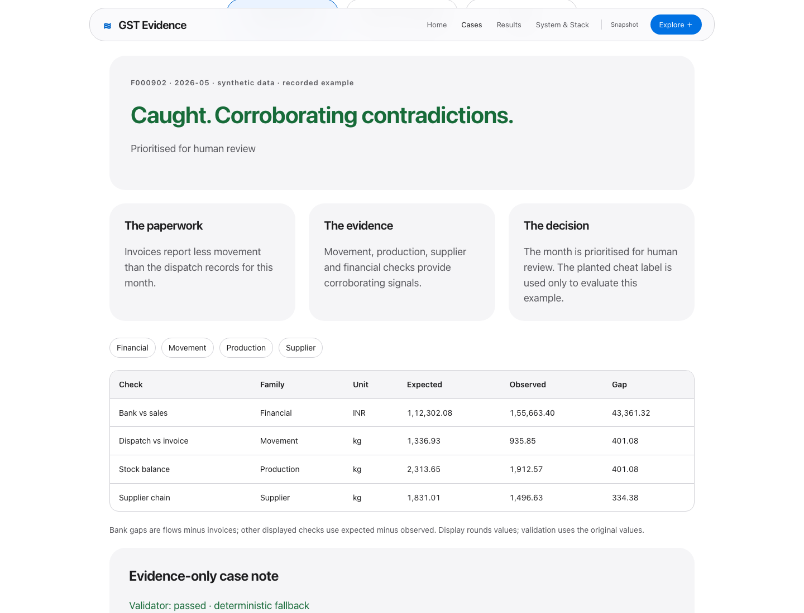
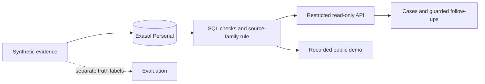

# GST Evidence

> A GST officer can’t tell which factories are hiding production or inflating tax credits, because every document she checks is declared by the factory itself, while the independent evidence (power use, goods movement, supplier records, bank flows) sits in separate places and is never compared. If this worked, she would start each week with a short list of units whose paperwork contradicts physical reality, each contradiction spelled out, and honest-but-unusual factories cleared.

**Turn conflicting records into a review list a GST officer can explain.**

[Explore the demo](https://kushagragupta2005.github.io/gst-evidence-reconciliation/) · [Watch the video](https://github.com/kushagragupta2005/gst-evidence-reconciliation/releases/tag/walkthrough-2026-10-29) · [Pitch deck](deliverables/exathon-india-2026-pitch.pdf) · [Run locally](#run-locally)

**ExaThon India 2026 · Track 01: Money, Risk & Regulation**

Built by **Kushagra Gupta**, solo participant · Exasol Personal · MIT · All data synthetic

## Why it matters

Matching one declaration against another can miss the bigger contradiction: the factory reports one story, while goods movement, power use, supplier records and bank flows suggest another. GST Evidence brings those records together and shows exactly where they disagree—so an officer has a reason to investigate, not just a risk score.

## See the evidence

[](https://kushagragupta2005.github.io/gst-evidence-reconciliation/cases/)

Explore a **caught cheat**, an **honest exception with a reason**, and a **miss**. The public demo uses recorded synthetic cases; local guarded follow-ups can query Exasol live.

## How it works

1. **Reconcile:** six SQL checks compare production, dispatches, stock, supplier returns and bank flows.
2. **Corroborate:** at least two source families must fire before a month is prioritised. Three prioritised months put a factory in the review queue.
3. **Explain:** each case keeps its expected value, observed value, gap, source families and validated note.

The difference is the evidence trail: operational and financial records are compared with declarations, honest exceptions are tested, and missed cheats remain visible. SQL rules decide priority. No ML model or LLM decides flags; demonstrated notes use the deterministic fallback.



Exasol is the primary analytical database: joins, window functions and grouped calculations turn separate records into evidence rows. It is not a storage placeholder. Workload timings and the DuckDB comparison are reported with their limits; no general speed advantage is claimed.

## Measured results

**2,400 synthetic factories · 12 months · 28,800 factory-months · 172,800 check rows per seed.** V3-A selected threshold **0.05** and **K=3**; B and C evaluated those frozen choices.

| Held-out seed | Cheating months caught | Honest months falsely flagged | Precision |
|---|---:|---:|---:|
| V3-B · primary test | 81.14% | 2.20% | 85.56% |
| V3-C · confirmation test | 81.24% | 2.28% | 85.01% |

These measure synthetic scenario recovery, not real-world fraud accuracy. Factory-cluster bootstrap intervals, factory-level scores, decoys, misses and ablation are available in [Results](https://kushagragupta2005.github.io/gst-evidence-reconciliation/results/) and the source reports: [V3-B](results.json), [V3-C](reports/v3_c_results.json).

**Known limits:** verification statuses are generated; sophisticated-forger testing, ablation intervals, current full-scale testing and second-machine reproduction remain open. Ranking has a documented exposure tie-breaker mismatch. An alert is a review lead, not proof of fraud. [Full limitations](LIMITATIONS.md).

## Run locally

Requires Git, Make and **Python 3.12+**. The recorded demo and audit need no database or API key.

```sh
git clone https://github.com/kushagragupta2005/gst-evidence-reconciliation.git
cd gst-evidence-reconciliation
sh scripts/bootstrap.sh
make all
make site
```

Open **http://127.0.0.1:8081/**. `make all` runs tests, restores hash-verified scoring inputs, rechecks metrics and builds the site. It does not replace the database. For live Exasol setup, loading, run commands and expected output, see the [run guide](docs/RUN_GUIDE.md).

The author-machine offline clone passed at the exact commit in [the reproduction report](reports/clean_setup.json), using a fresh venv and cached pinned wheels. Not yet tested on a second machine. Public Pages serves the snapshot; the Live API stays on localhost.

## Submission and evidence

| Open this | What it contains |
|---|---|
| [Pitch PDF](deliverables/exathon-india-2026-pitch.pdf) / [editable PPTX](deliverables/exathon-india-2026-pitch.pptx) | Problem, method, V3 results and limits |
| [Final submission video](https://github.com/kushagragupta2005/gst-evidence-reconciliation/releases/tag/walkthrough-2026-10-29) | Original recording by Kushagra Gupta |
| [Submission checklist](SUBMISSION_CHECKLIST.md) | Materials, owner actions and conflicting official deadline notices |
| [Implementation status](PROJECT_STATUS.md) / [technical audit](docs/JUDGE_AUDIT.md) | Verified features, recorded runs and open gaps |
| [Reproduction inputs](data/audit/README.md) / [report index](reports/ARTIFACT_INDEX.json) | Exact synthetic inputs and current-versus-historical evidence |

## Data, licences and AI disclosure

All records and labels come from [the seeded generator](src/generate.py). There are no real taxpayer records or live tax, power or bank integrations. Real deployment would require lawful access, privacy controls and human review.

Project source is [MIT](LICENSE). Python dependencies, browser tooling and optional authoring tools are disclosed in [THIRD_PARTY.md](THIRD_PARTY.md), [THIRD_PARTY_NODE.md](THIRD_PARTY_NODE.md) and [THIRD_PARTY_DELIVERABLES.md](THIRD_PARTY_DELIVERABLES.md). Exasol Personal uses its own EULA; the optional OpenAI API uses its service terms. [Licence review](docs/LICENCE_AUDIT.md).

OpenAI Codex coding assistants helped build and audit the project. The optional LLM note path is implemented but no API-key-backed demonstration is claimed. Kushagra Gupta is responsible for final review and submission.
