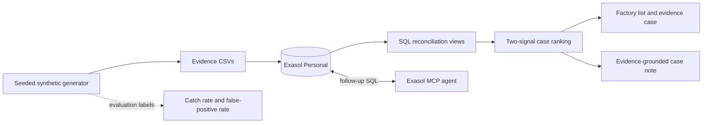

# GST Evidence Reconciliation

> A GST officer can’t tell which factories are hiding production or inflating tax credits, because every document she checks is declared by the factory itself, while the independent evidence (power use, goods movement, supplier records, bank flows) sits in separate places and is never compared. If this worked, she would start each week with a short list of units whose paperwork contradicts physical reality, each contradiction spelled out, and honest-but-unusual factories cleared.

## What it does

This project creates reproducible synthetic GST evidence, loads it into Exasol Personal, and runs four conservation and reconciliation checks. Each result contains the entity, period, expected value, observed value, gap, and source evidence. A unit is prioritised only when at least two independent check families support the concern. Single-signal cases remain in review, while factories with no discrepancy evidence appear as clear. Ground-truth labels are used only to measure catch rate and false-positive rate; they are not used by the checks.

The first version covers material input versus declared output, dispatches versus invoices, stock roll-forward, and supplier-chain/invoice-loop signals. Honest factories with a machinery change, product-mix shift, or longer operating hours are included as decoys.

## Event fit

The [official ExaThon India 2026 page](https://www.exasol.com/events/exathon-india-2026/) lists teams of 1–3, registration closing 15 October 2026, and submission closing 25 October 2026 at 11:59 pm IST. The event requires Exasol Personal, synthetic or public data, a public GitHub repository, and an Apache-2.0 or MIT licence. The team is registered, as confirmed by the project owner.

## Quick start

1. Install Python 3.11+. Install the launcher using the [official Exasol Personal repository](https://github.com/exasol/exasol-personal#-get-started), then start the database:

   ```sh
   curl -fsSL https://downloads.exasol.com/exasol-personal/installer.sh | sh
   export PATH="$HOME/.local/bin:$PATH"
   exasol install local
   ```

2. Run `exasol connect` and execute `SELECT 1;` to confirm the database is available.
3. Run `sh run_demo.sh` from the repository root. This generates the small seeded dataset, creates a Python virtual environment, installs the dependencies, loads all CSVs, applies the SQL views, reports catch rate, decoy false-positive rate, row counts and query time, then starts the dashboard.

For a larger run, use `SCALE=medium sh run_demo.sh` or `SCALE=large sh run_demo.sh`. Set `EXASOL_DSN`, `EXASOL_USER`, and `EXASOL_PASSWORD` to override the local defaults. The large generator writes 120,000 factories and 360,000 monthly rows incrementally; it keeps outward sales invoices separate from supplier purchase invoices. All generated files together contain 2,510,000 data rows.

To use the optional note-writing LLM, set `OPENAI_API_KEY` before starting the dashboard and optionally set `OPENAI_MODEL`. The model receives only evidence rows returned from Exasol. Every note is checked against those rows; a note containing a number not present in the evidence is withheld. The deterministic note remains available without an API key.

To let an external agent query the same database, install the [Exasol Personal Local Starter Kit](https://github.com/exasol-labs/exasol-personal-local-starterkit), then connect and verify its read-only MCP server:

```sh
curl https://www.exasol.com/install/starter-kit.sh | sh
exakit mcp-setup
exakit mcp-doctor
```

## Scope

### MVP checks

1. Material in versus declared output
2. Dispatches versus invoices
3. Stock roll-forward (opening + purchases + production − dispatches = closing)
4. Supplier-chain trace and invoice-loop signals

Machine capacity, undeclared premises, shared addresses and vehicles, and valuation are stretch goals.

### Discrepancy classes

`mismatch`, `missing documents`, `supplier issue`, `contradicting evidence`, and `needs human review`. Automated prioritisation requires support from at least two independent check families. The LLM case-note layer is intentionally advisory and must quote only evidence returned by SQL.

## Data and licences

All records are synthetic and generated by `src/generate.py`; no real taxpayer data is used.

| Component | Source | Licence / terms |
| --- | --- | --- |
| Synthetic evidence | `src/generate.py`; Python standard library | Generated data; Python standard library under the PSF licence |
| Database client | [PyExasol](https://github.com/exasol/pyexasol) | MIT |
| Dashboard | [Streamlit](https://github.com/streamlit/streamlit) | Apache-2.0 |
| Optional note-writing SDK | [OpenAI Python SDK](https://github.com/openai/openai-python) | MIT |
| Optional note-writing service | OpenAI API | API service terms and usage charges apply; only SQL evidence rows are sent |
| Demo video | macOS built-in speech synthesis and FFmpeg | Platform/tool licences apply; generated video is included in `deliverables/` |
| Analytics database | [Exasol Personal](https://github.com/exasol/exasol-personal) | Exasol software, free for personal use under Exasol's EULA |
| This project | `LICENSE` | MIT |

## Evaluation

The generator writes ground-truth labels alongside the synthetic records. Scoring reports cheat catch rate and honest-decoy false-positive rate, using those labels only after SQL results have been produced.

Measured on Exasol Personal's local 8 GB VM with the seeded large dataset (120,000 factories, 360,000 factory-months, 2,510,000 evidence rows):

| Measure | Result |
| --- | ---: |
| Planted cheats caught | 24,000 / 24,000 (100.0%) |
| Honest decoys prioritized | 0 / 24,000 (0.0% false-positive rate) |
| Material/output view | 0.012 s |
| Dispatch/invoice view | 1.004 s |
| Stock roll-forward view | 0.011 s |
| Supplier-loop view | 0.729 s |
| Ranked cases view | 1.299 s |
| Prioritized-case query | 1.407 s |

These are synthetic-data results from one local run; they are not a claim about real tax investigations or a production Exasol cluster. The prioritization result is factory-month level, and the catch/FPR calculations count a factory as caught/prioritized if any of its three months is prioritized.

## Architecture



## Pitch and demo

- [Five-slide pitch deck](deliverables/exathon-india-2026-pitch.pptx)
- [Narrated demo video, 2:17](deliverables/exathon-india-2026-demo.mp4)
- [Timed demo outline and research sources](docs/demo_and_pitch.md)
- [Demo narration script](docs/demo_script.md)

## Team roles

| Seat | Responsibilities |
| --- | --- |
| Member 1 | Synthetic data generator, Exasol schema and SQL checks |
| Member 2 | LLM and MCP agent, evidence-only notes and number guard |
| Member 3 | Dashboard, scoring review, pitch deck and demo video |

Combine seats for a solo or two-person team. The event permits up to three members.

## Submission checklist

- [ ] Public GitHub repository
- [x] Exasol Personal one-query smoke check (`SELECT 1` returned `1`)
- [x] Reproducible data generation, load, and checks (one-command setup run)
- [x] Catch rate, honest-decoy false-positive rate, and full-scale query times
- [x] Evidence-only case notes and number verification
- [x] Minimal ranked list and evidence timeline
- [x] Pitch deck and narrated demo video (2 minutes 17 seconds)
- [ ] Clean-machine setup and final event-rule review

