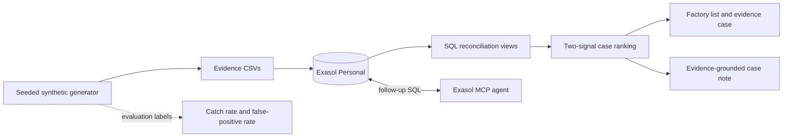

# GST Evidence Reconciliation

> A GST officer can’t tell which factories are hiding production or inflating tax credits, because every document she checks is declared by the factory itself, while the independent evidence (power use, goods movement, supplier records, bank flows) sits in separate places and is never compared. If this worked, she would start each week with a short list of units whose paperwork contradicts physical reality, each contradiction spelled out, and honest-but-unusual factories cleared.

## What it does

This project creates reproducible synthetic GST evidence, loads it into Exasol Personal, and runs four conservation and reconciliation checks. Each result contains the entity, period, expected value, observed value, gap, and source evidence. A unit is prioritised only when at least two distinct source families support the concern. Single-signal cases remain in review, while factories with no discrepancy evidence appear as clear. Ground-truth labels are used only to measure catch rate and false-positive rate; they are not used by the checks.

**Project author:** Kushagra Gupta. This is a solo project; Kushagra handled the data generator, Exasol schema and SQL checks, LLM/MCP layer, dashboard, scoring, pitch deck, and demo.

The current version covers material input versus declared output, dispatches versus invoices, stock roll-forward, and supplier-chain/invoice-loop signals. Six hard decoy types exercise source-specific false alarms; financial checks corroborate the four core reconciliation checks.

## Event fit

The [official ExaThon India 2026 page](https://www.exasol.com/events/exathon-india-2026/) lists teams of 1–3, registration closing 15 October 2026, and submission closing 25 October 2026 at 11:59 pm IST. The event requires Exasol Personal, synthetic or public data, a public GitHub repository, and an Apache-2.0 or MIT licence. Kushagra Gupta is registered as the sole participant for this project.

## Quick start

1. Install Python 3.11+. Install the launcher using the [official Exasol Personal repository](https://github.com/exasol/exasol-personal#-get-started), then start the database:

   ```sh
   curl -fsSL https://downloads.exasol.com/exasol-personal/installer.sh | sh
   export PATH="$HOME/.local/bin:$PATH"
   exasol install local
   ```

2. Run `exasol connect` and execute `SELECT 1;` to confirm the database is available.
3. Run `sh run_demo.sh` from the repository root. This generates the small seeded dataset, creates a Python virtual environment, installs the dependencies, loads all CSVs, applies the SQL views, reports catch rate, decoy false-positive rate, row counts and query time, then starts the dashboard.

The default run evaluates two medium datasets using `scripts/evaluate.sh`. Set `EXASOL_DSN`, `EXASOL_USER`, and `EXASOL_PASSWORD` to override the local defaults. The generator streams 12 months per factory. Outward invoices and supplier purchase invoices are separate. The current measured evaluation is below; scale results will be recorded separately.

To use the optional note-writing LLM, set `OPENAI_API_KEY` before starting the dashboard and optionally set `OPENAI_MODEL`. The model receives only evidence rows returned from Exasol. Every note is checked against those rows; a note containing a number not present in the evidence is withheld. The deterministic note remains available without an API key.

To let an external agent query the same database, install the [Exasol Personal Local Starter Kit](https://github.com/exasol-labs/exasol-personal-local-starterkit), then connect and verify its read-only MCP server:

```sh
curl https://www.exasol.com/install/starter-kit.sh | sh
exakit mcp-setup
exakit mcp-doctor
```

## Scope

### MVP checks

1. Material in versus declared output
2. Dispatches versus invoices
3. Stock roll-forward (opening + purchases + production − dispatches = closing)
4. Supplier-chain trace and invoice-loop signals

Machine capacity, undeclared premises, shared addresses and vehicles, and valuation are stretch goals.

### Discrepancy classes

`mismatch`, `missing documents`, `supplier issue`, `contradicting evidence`, and `needs human review`. Automated prioritisation requires support from at least two distinct source families. The LLM case-note layer is intentionally advisory and must quote only evidence returned by SQL.

## Data and licences

All records are synthetic and generated by `src/generate.py`; no real taxpayer data is used.

| Component | Source | Licence / terms |
| --- | --- | --- |
| Synthetic evidence | `src/generate.py`; Python standard library | Generated data; Python standard library under the PSF licence |
| Database client | [PyExasol](https://github.com/exasol/pyexasol) | MIT |
| Dashboard | [Streamlit](https://github.com/streamlit/streamlit) | Apache-2.0 |
| Optional note-writing SDK | [OpenAI Python SDK](https://github.com/openai/openai-python) | MIT |
| Optional note-writing service | OpenAI API | API service terms and usage charges apply; only SQL evidence rows are sent |
| Demo video | macOS built-in speech synthesis and FFmpeg | Platform/tool licences apply; generated video is included in `deliverables/` |
| Analytics database | [Exasol Personal](https://github.com/exasol/exasol-personal) | Exasol software, free for personal use under Exasol's EULA |
| This project | `LICENSE` | MIT |

<!-- EVALUATION START -->
<!-- Generated by scripts/report.py from results.json. -->
## Held-out evaluation

Seed A: 20261019; held-out B: 20261020. 2,400 factories × 12 months. Selected ratio threshold: 0.025. Minimum balanced error on A, with conservative tie-breaking; no target score. Labels never enter detection SQL.

| Unit | TP | FP | FN | TN | Recall [95% CI] | FPR [95% CI] |
|---|---:|---:|---:|---:|---|---|
| factory_month | 3409 | 4151 | 629 | 20611 | 84.42% [82.51%, 86.46%] | 16.76% [16.19%, 17.36%] |
| factory | 715 | 1414 | 5 | 266 | 99.31% [98.61%, 99.86%] | 84.17% [82.51%, 85.89%] |

Factory-month negatives include inactive months of cheat factories. Factory scores use any flagged month. Intervals use 1,000 factory-cluster bootstrap resamples, conditional on the selected threshold; they do not quantify generator bias.

### Recall by type and intensity

| Type / intensity | Factory-month recall [95% CI] | Factory recall [95% CI] |
|---|---|---|
| eway_reuse/5% | 86.76% [80.98%, 92.03%] | 100.00% [100.00%, 100.00%] |
| eway_reuse/15% | 84.01% [77.69%, 89.94%] | 100.00% [100.00%, 100.00%] |
| eway_reuse/30% | 83.86% [77.78%, 89.42%] | 98.88% [96.63%, 100.00%] |
| hidden_production/5% | 88.21% [82.15%, 93.70%] | 100.00% [100.00%, 100.00%] |
| hidden_production/15% | 82.91% [76.03%, 89.40%] | 97.62% [94.05%, 100.00%] |
| hidden_production/30% | 77.87% [69.23%, 85.50%] | 98.63% [95.89%, 100.00%] |
| itc_inflation/5% | 83.85% [77.75%, 88.89%] | 98.77% [96.30%, 100.00%] |
| itc_inflation/15% | 83.93% [76.05%, 90.91%] | 100.00% [100.00%, 100.00%] |
| itc_inflation/30% | 86.63% [80.79%, 91.56%] | 100.00% [100.00%, 100.00%] |

### Honest decoy false positives

| Decoy | Factory-month FPR [95% CI] | Factory FPR [95% CI] |
|---|---|---|
| longer_hours | 24.84% [23.12%, 26.72%] | 98.75% [96.88%, 100.00%] |
| lumpy_bank_flows | 26.30% [24.37%, 28.23%] | 97.50% [95.00%, 99.38%] |
| machinery_upgrade | 25.26% [23.38%, 27.14%] | 95.62% [91.88%, 98.75%] |
| new_supplier_onboarding | 31.20% [29.06%, 33.23%] | 97.50% [95.00%, 99.38%] |
| product_mix_shift | 24.48% [22.60%, 26.35%] | 96.25% [93.12%, 98.75%] |
| seasonal_stock_build | 25.31% [23.28%, 27.29%] | 96.25% [93.12%, 98.75%] |

6,924 honest decoy months triggered exactly one source family and were not prioritised. Review-only means excluded from the priority queue, not legally cleared.

### Review queue precision

| k | Mean precision [95% CI] |
|---:|---|
| 50 | 18.17% [13.83%, 21.68%] |
| 200 | 51.58% [47.58%, 54.76%] |

Monthly snapshots approximate a weekly workload; there is no weekly-resolution dataset. Each returns up to k flagged factories, with no padding. Empty months are excluded. Queue intervals use 200 factory-cluster resamples and recompute the ranks. Per-month returned counts are in results.json.

### Discrepancy classification

Rows are truth; columns are predicted. Strongest non-financial signal determines the case class, including review-only cases. Clean months are excluded. `no signal` records abstention. These classes describe evidence, not guilt.

| Truth | mismatch | missing documents | supplier issue | contradicting evidence | needs human review | no signal |
|---|---:|---:|---:|---:|---:|---:|
| mismatch | 1242 | 0 | 0 | 0 | 0 | 0 |
| missing documents | 0 | 1546 | 0 | 0 | 0 | 0 |
| supplier issue | 0 | 0 | 1295 | 15 | 35 | 4 |
| contradicting evidence | 241 | 0 | 6 | 722 | 372 | 0 |
| needs human review | 0 | 0 | 155 | 2935 | 4110 | 0 |

### Misses and limits

Missed 629 active cheat months; 5 cheat factories were never caught. Full rows and reasons: [misses.csv](reports/misses.csv). Evasive factory-month recall: 39.04% [36.15%, 41.93%].

| Factory | Month | Scenario | Intensity | Signals | Reason |
|---|---|---|---:|---:|---|
| F000006 | 2026-05 | eway_reuse | 5.00% | 1 | only one independent source family exceeded threshold |
| F000006 | 2026-06 | eway_reuse | 5.00% | 1 | only one independent source family exceeded threshold |
| F000006 | 2026-09 | eway_reuse | 5.00% | 1 | only one independent source family exceeded threshold |
| F000006 | 2026-10 | eway_reuse | 5.00% | 1 | only one independent source family exceeded threshold |
| F000020 | 2026-10 | itc_inflation | 5.00% | 1 | only one independent source family exceeded threshold |


The curve is diagnostic on B and was not used to select the threshold. A and B share one generator: results measure synthetic scenario recovery only. Independent source groups can still be correlated in reality. Supplier ownership and one primary supplier per factory are simplifying assumptions. The fixed yield/power model intentionally struggles with legitimate operating changes. Zero observed false positives would not prove zero real-world risk.
<!-- EVALUATION END -->

## Architecture



## Pitch and demo

- [Five-slide pitch deck](deliverables/exathon-india-2026-pitch.pptx)
- Prior narrated video is superseded by this evaluation; replacement live capture pending.
- [Timed demo outline and research sources](docs/demo_and_pitch.md)
- [Demo narration script](docs/demo_script.md)

## Project authorship

Kushagra Gupta built this project independently, including the synthetic data generator, Exasol schema and SQL checks, evidence-only LLM/MCP layer, dashboard, scoring, pitch deck, and demo video. There are no other project team members.

## Submission checklist

- [x] Public GitHub repository publication: https://github.com/kushagragupta2005/gst-evidence-reconciliation
- [x] Exasol Personal one-query smoke check (`SELECT 1` returned `1`)
- [x] Reproducible data generation, load, and checks (one-command setup run)
- [x] Catch rate, honest-decoy false-positive rate, and full-scale query times
- [x] Evidence-only case notes and number verification
- [x] Minimal ranked list and evidence timeline
- [ ] Updated pitch deck and live demo recording
- [x] Event team rules and submission deadline rechecked
- [x] Fresh exported-checkout setup run on the same Mac
- [ ] Clean separate-machine setup
- [ ] Submit to the event portal before the deadline

The fresh-checkout run reused the Exasol Personal installation already on this Mac; it did not verify a separate machine's Exasol installation.

