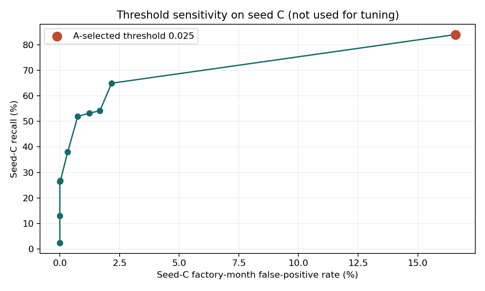
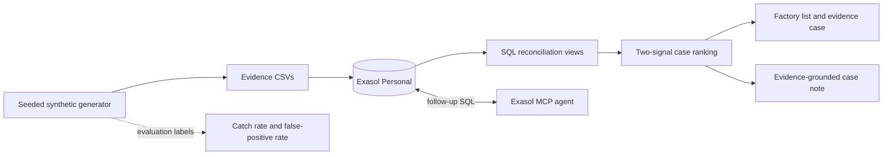
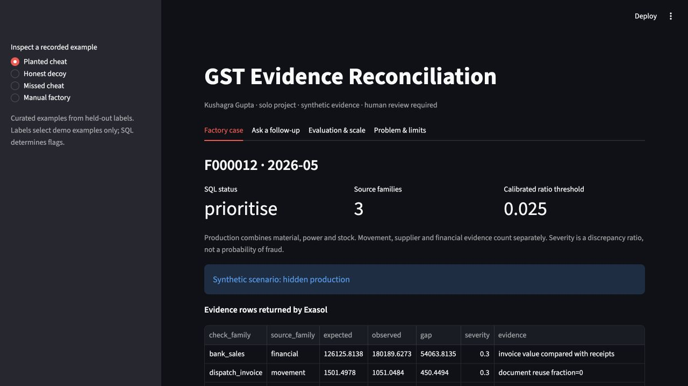
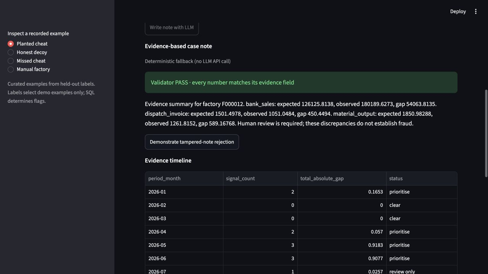
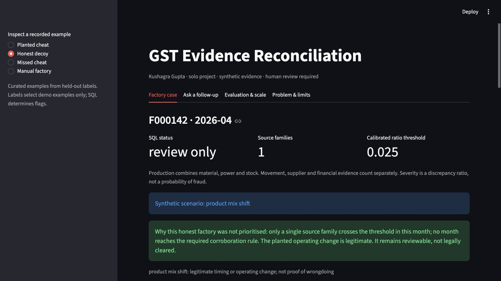
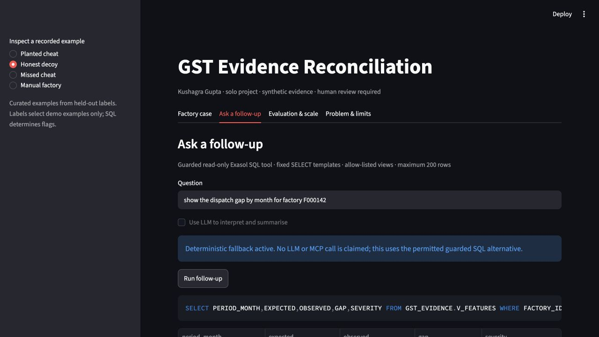

# GST Evidence Reconciliation

> A GST officer can’t tell which factories are hiding production or inflating tax credits, because every document she checks is declared by the factory itself, while the independent evidence (power use, goods movement, supplier records, bank flows) sits in separate places and is never compared. If this worked, she would start each week with a short list of units whose paperwork contradicts physical reality, each contradiction spelled out, and honest-but-unusual factories cleared.

## What it does

This project creates reproducible synthetic GST evidence, loads it into Exasol Personal, and runs four conservation and reconciliation checks. Each result contains the entity, period, expected value, observed value, gap, and source evidence. A unit is prioritised only when at least two distinct source families support the concern. Single-signal cases remain in review, while factories with no discrepancy evidence appear as clear. Ground-truth labels are used only to measure catch rate and false-positive rate; they are not used by the checks.

**Project author:** Kushagra Gupta. This is a solo project with no other team members. Kushagra made the project decisions and built the implementation. AI coding assistants helped with code, debugging, documentation and presentation work; Kushagra reviewed changes and verified reported results.

The current version covers material input versus declared output, dispatches versus invoices, stock roll-forward, and supplier-chain/invoice-loop signals. Six hard decoy types exercise source-specific false alarms; financial checks corroborate the four core reconciliation checks.

## Event fit

The [official ExaThon India 2026 page](https://www.exasol.com/events/exathon-india-2026/) lists teams of 1–3, registration closing 15 October 2026, and submission closing 25 October 2026 at 11:59 pm IST. This project selects Track 03, **Factories, Fleets & Supply Chains**, which covers manufacturing, logistics, mobility and energy. The event requires Exasol Personal, synthetic or public data, a public GitHub repository, and an Apache-2.0 or MIT licence. Kushagra Gupta is registered as the sole participant for this project.

## Quick start

1. Install Python 3.12+. Install the launcher using the [official Exasol Personal repository](https://github.com/exasol/exasol-personal#-get-started), then start the database:

   ```sh
   curl -fsSL https://downloads.exasol.com/exasol-personal/installer.sh | sh
   export PATH="$HOME/.local/bin:$PATH"
   exasol install local
   ```

2. Run `exasol connect` and execute `SELECT 1;` to confirm the database is available.
3. Run `sh run_demo.sh` from the repository root. This creates a virtual environment from pinned dependencies, generates and loads seeds A and B, runs SQL checks, scores held-out results, refreshes dashboard views, and starts the dashboard. Configure the existing read-only account described below first.

The default run evaluates two medium datasets using `scripts/evaluate.sh`. Set `EXASOL_DSN`, `EXASOL_USER`, and `EXASOL_SECRET` to override the local defaults. The generator streams 12 months per factory. Outward invoices and supplier purchase invoices are separate. The current measured evaluation is below; scale results are recorded separately below.

To use the optional note-writing LLM, set `OPENAI_API_KEY` before starting the dashboard and optionally set `OPENAI_MODEL`. The model receives only evidence rows returned from Exasol. Every note is checked against those rows; a note containing a number not present in the evidence is withheld. The deterministic note remains available without an API key.

To let an external agent query the same database, install the [Exasol Personal Local Starter Kit](https://github.com/exasol-labs/exasol-personal-local-starterkit), then connect and verify its read-only MCP server:

```sh
curl https://www.exasol.com/install/starter-kit.sh | sh
exakit mcp-setup
exakit mcp-doctor
```

## Scope

### MVP checks

1. Material in versus declared output
2. Dispatches versus invoices
3. Stock roll-forward (opening + purchases + production − dispatches = closing)
4. Supplier-chain trace and invoice-loop signals

Machine capacity, undeclared premises, shared addresses and vehicles, and valuation are stretch goals.

### Discrepancy classes

`mismatch`, `missing documents`, `supplier issue`, `contradicting evidence`, and `needs human review`. Automated prioritisation requires support from at least two distinct source families. The LLM case-note layer is intentionally advisory and must quote only evidence returned by SQL.

## Data and licences

All records are synthetic and generated by `src/generate.py`; no real taxpayer data is used.

| Component | Source | Licence / terms |
| --- | --- | --- |
| Synthetic evidence | `src/generate.py`; Python standard library | Generated data; Python standard library under the PSF licence |
| Database client | [PyExasol](https://github.com/exasol/pyexasol) | MIT |
| Dashboard | [Streamlit](https://github.com/streamlit/streamlit) | Apache-2.0 |
| Optional note-writing SDK | [OpenAI Python SDK](https://github.com/openai/openai-python) | MIT |
| Optional note-writing service | OpenAI API | API service terms and usage charges apply; only SQL evidence rows are sent |
| Analytics database | [Exasol Personal](https://github.com/exasol/exasol-personal) | Exasol software, free for personal use under Exasol's EULA |
| This project | `LICENSE` | MIT |

The complete Python dependency licence inventory is in [THIRD_PARTY.md](THIRD_PARTY.md), generated with `sh scripts/generate_third_party.sh`. The installed Exasol Personal EULA was checked on 21 October 2026; it contains no benchmark-publication clause. Performance figures are labelled as workload timings on the project author's MacBook.

<!-- EVALUATION START -->
<!-- Generated by scripts/report.py from results.json. -->
## Held-out evaluation (v2)

Seed A selected the ratio threshold and factory queue rule once. Fresh seed C (2,400 factories × 12 months) reports the results below; fake benign explanations for C cheats are retained only in external truth data. The monthly SQL rule remains two independent source families. Threshold: 0.025; factory queue K: 4.

### v1 versus v2

| Evaluation | Unit | Recall | FPR | TP | FP | FN | TN |
|---|---|---:|---:|---:|---:|---:|---:|
| v1 seed B | factory_month | 84.42% | 16.76% | 3409 | 4151 | 629 | 20611 |
| v1 seed B | factory | 99.31% | 84.17% | 715 | 1414 | 5 | 266 |
| v2 seed C | factory_month | 84.01% | 16.58% | 3283 | 4128 | 625 | 20764 |
| v2 seed C | factory | 74.72% | 22.56% | 538 | 379 | 182 | 1301 |

v1 is retained for comparison. v2 is the current held-out evaluation. Both are synthetic scenario recovery, not estimates of deployment accuracy.

### v2 metrics and queue

| Unit | TP | FP | FN | TN | Recall [95% CI] | FPR [95% CI] |
|---|---:|---:|---:|---:|---|---|
| factory_month | 3283 | 4128 | 625 | 20764 | 84.01% [81.81%, 86.29%] | 16.58% [16.03%, 17.19%] |
| factory | 538 | 379 | 182 | 1301 | 74.72% [71.46%, 77.84%] | 22.56% [20.70%, 24.73%] |

A factory enters the weekly review queue after 4 prioritised months. On seed C it contains 917 factories; its recall/FPR are 74.72% / 22.56%. K candidates and seed-A calibration are recorded in `results.json`.

### Recall by cheat type and intensity

| Type / intensity | Factory-month recall [95% CI] | Factory recall [95% CI] |
|---|---|---|
| eway_reuse/5% | 85.33% [78.29%, 91.60%] | 80.60% [70.15%, 89.55%] |
| eway_reuse/15% | 82.73% [76.58%, 88.96%] | 70.00% [60.00%, 78.89%] |
| eway_reuse/30% | 85.20% [78.86%, 90.63%] | 77.11% [67.47%, 85.54%] |
| hidden_production/5% | 88.00% [79.95%, 94.76%] | 76.71% [67.12%, 86.30%] |
| hidden_production/15% | 82.88% [75.69%, 89.35%] | 72.83% [64.13%, 81.52%] |
| hidden_production/30% | 85.99% [78.29%, 92.48%] | 76.00% [66.67%, 85.33%] |
| itc_inflation/5% | 78.34% [71.78%, 84.72%] | 68.60% [58.14%, 77.91%] |
| itc_inflation/15% | 79.67% [73.12%, 85.86%] | 71.76% [61.18%, 81.18%] |
| itc_inflation/30% | 90.53% [83.90%, 96.25%] | 82.61% [73.91%, 91.30%] |

### False positives: clean factories, decoys and evidence pairs

| Negative group | Factory-month FPR | Factory FPR |
|---|---|---|
| clean factories | 8.62% [8.00%, 9.24%] | 1.81% [0.83%, 2.78%] |
| honest decoys | 26.01% [25.16%, 26.82%] | 38.12% [35.00%, 41.25%] |

| Decoy | Factory-month FPR | Factory FPR |
|---|---|---|
| longer hours | 26.77% [24.89%, 28.59%] | 41.88% [34.38%, 48.75%] |
| lumpy bank flows | 23.49% [21.56%, 25.68%] | 30.00% [23.12%, 37.50%] |
| machinery upgrade | 23.49% [21.72%, 25.31%] | 28.12% [21.25%, 35.00%] |
| new supplier onboarding | 30.94% [28.85%, 33.02%] | 54.37% [46.86%, 62.50%] |
| product mix shift | 25.83% [23.91%, 27.81%] | 35.62% [28.12%, 43.12%] |
| seasonal stock build | 25.52% [23.49%, 27.60%] | 38.75% [31.25%, 46.25%] |

| Decoy / fired source families | Months | False positives | FPR |
|---|---:|---:|---:|
| longer hours / financial | 78 | 0 | 0.00% |
| longer hours / financial+production | 321 | 321 | 100.00% |
| longer hours / financial+production+supplier | 38 | 38 | 100.00% |
| longer hours / financial+supplier | 7 | 7 | 100.00% |
| longer hours / none | 253 | 0 | 0.00% |
| longer hours / production | 1043 | 0 | 0.00% |
| longer hours / production+supplier | 148 | 148 | 100.00% |
| longer hours / supplier | 32 | 0 | 0.00% |
| lumpy bank flows / financial | 1093 | 0 | 0.00% |
| lumpy bank flows / financial+production | 269 | 269 | 100.00% |
| lumpy bank flows / financial+production+supplier | 37 | 37 | 100.00% |
| lumpy bank flows / financial+supplier | 134 | 134 | 100.00% |
| lumpy bank flows / none | 280 | 0 | 0.00% |
| lumpy bank flows / production | 71 | 0 | 0.00% |
| lumpy bank flows / production+supplier | 11 | 11 | 100.00% |
| lumpy bank flows / supplier | 25 | 0 | 0.00% |
| machinery upgrade / financial | 74 | 0 | 0.00% |
| machinery upgrade / financial+production | 288 | 288 | 100.00% |
| machinery upgrade / financial+production+supplier | 28 | 28 | 100.00% |
| machinery upgrade / financial+supplier | 7 | 7 | 100.00% |
| machinery upgrade / none | 276 | 0 | 0.00% |
| machinery upgrade / production | 1082 | 0 | 0.00% |
| machinery upgrade / production+supplier | 128 | 128 | 100.00% |
| machinery upgrade / supplier | 37 | 0 | 0.00% |
| new supplier onboarding / financial | 68 | 0 | 0.00% |
| new supplier onboarding / financial+production | 16 | 16 | 100.00% |
| new supplier onboarding / financial+production+supplier | 72 | 72 | 100.00% |
| new supplier onboarding / financial+supplier | 248 | 248 | 100.00% |
| new supplier onboarding / none | 268 | 0 | 0.00% |
| new supplier onboarding / production | 80 | 0 | 0.00% |
| new supplier onboarding / production+supplier | 258 | 258 | 100.00% |
| new supplier onboarding / supplier | 910 | 0 | 0.00% |
| product mix shift / financial | 58 | 0 | 0.00% |
| product mix shift / financial+production | 307 | 307 | 100.00% |
| product mix shift / financial+production+supplier | 31 | 31 | 100.00% |
| product mix shift / financial+supplier | 10 | 10 | 100.00% |
| product mix shift / none | 280 | 0 | 0.00% |
| product mix shift / production | 1046 | 0 | 0.00% |
| product mix shift / production+supplier | 148 | 148 | 100.00% |
| product mix shift / supplier | 40 | 0 | 0.00% |
| seasonal stock build / financial | 66 | 0 | 0.00% |
| seasonal stock build / financial+production | 294 | 294 | 100.00% |
| seasonal stock build / financial+production+supplier | 38 | 38 | 100.00% |
| seasonal stock build / financial+supplier | 10 | 10 | 100.00% |
| seasonal stock build / none | 269 | 0 | 0.00% |
| seasonal stock build / production | 1069 | 0 | 0.00% |
| seasonal stock build / production+supplier | 148 | 148 | 100.00% |
| seasonal stock build / supplier | 26 | 0 | 0.00% |

6,898 honest decoy months fired exactly one source family. They are not prioritised; a disposition can mark documented operating changes as cleared or leave them review-only.

### Ranking and review capacity

The predeclared sort key is: number of source families firing, then weakest-link normalised gap, then value-at-risk proxy. Ranking variants were compared on seed A only; v2 reports seed C. Value at risk is the largest evidence gap monetised with the synthetic per-kg amount, or the bank amount itself; it is an ordering proxy, not a tax assessment.

| If you can review K cases per snapshot | Observed seed-C synthetic precision |
|---:|---:|
| 50 | 75.00% |
| 200 | 64.54% |

| Seed-A sort test (top 50) | Mean precision |
|---|---:|
| families only | 65.17% |
| families then weakest link | 75.00% |
| families then weakest link then value at risk | 75.00% |

### Prevalence-adjusted precision

These are illustrative recalculations using the held-out sensitivity and FPR. They do not assert fraud prevalence in any real population.

| Assumed cheat prevalence | Precision |
|---|---:|
| 1.00% | 4.87% |
| 5.00% | 21.05% |
| 10.00% | 36.01% |
| synthetic observed | 44.30% |

### Robustness sweep

Each variant uses the frozen seed-A threshold and K. No robustness result changes calibration.

| Variant | Monthly recall | Monthly FPR | Factory queue size |
|---|---:|---:|---:|
| noise 1 5x | 91.91% | 46.99% | 2167 |
| noise 2x | 95.68% | 68.89% | 2391 |
| missing documents 10pct | 83.53% | 24.95% | 1297 |

### Discrepancy classification

Rows are truth and columns are evidence classifications. The strongest non-financial signal determines the class; `no signal` is abstention. Classes describe evidence, not guilt.

| Truth | mismatch | missing documents | supplier issue | contradicting evidence | needs human review | no signal |
|---|---:|---:|---:|---:|---:|---:|
| mismatch | 1192 | 0 | 0 | 0 | 0 | 0 |
| missing documents | 0 | 1533 | 0 | 0 | 0 | 0 |
| supplier issue | 0 | 0 | 1275 | 14 | 36 | 4 |
| contradicting evidence | 268 | 0 | 8 | 709 | 309 | 0 |
| needs human review | 0 | 0 | 144 | 2941 | 4115 | 0 |

### Misses and limits

Missed 625 active cheat months; 182 cheat factories did not enter the K-month factory queue. Full rows and reasons: [misses.csv](reports/misses.csv).

| Factory | Month | Scenario | Intensity | Signals | Reason |
|---|---|---|---:|---:|---|
| F000003 | 2026-06 | itc_inflation | 15.00% | 1 | only one independent source family exceeded threshold |
| F000003 | 2026-07 | itc_inflation | 15.00% | 1 | only one independent source family exceeded threshold |
| F000007 | 2026-05 | hidden_production | 15.00% | 1 | only one independent source family exceeded threshold |
| F000018 | 2026-08 | itc_inflation | 15.00% | 1 | only one independent source family exceeded threshold |
| F000047 | 2026-08 | hidden_production | 5.00% | 1 | only one independent source family exceeded threshold |



The curve is diagnostic on seed C and did not select the threshold. A, B and C share a deliberately limited generator. Synthetic data does not establish real-world accuracy, causal independence or legal sufficiency. Every case needs human review; access to power and bank data requires lawful authorisation and privacy safeguards.
<!-- EVALUATION END -->

## Architecture



## Pitch and demo

- [Five-slide pitch deck (PPTX)](deliverables/exathon-india-2026-pitch.pptx) and [PDF export](output/pdf/exathon-india-2026-pitch.pdf)
- The existing MP4 predates the held-out evaluation and is not the submission demo. The replacement recording is being made by the solo participant using [the timed outline](docs/demo_script.md).
- [Timed demo outline and research sources](docs/demo_and_pitch.md)
- [Demo narration script](docs/demo_script.md)
- [Likely judge questions and truthful answers](docs/judge_qa.md)

## Project authorship

Kushagra Gupta is the only project participant. AI coding assistants helped during implementation and documentation; see the disclosure above.

## Submission checklist

- [x] Public GitHub repository publication: https://github.com/kushagragupta2005/gst-evidence-reconciliation
- [x] Exasol Personal one-query smoke check (`SELECT 1` returned `1`)
- [x] Reproducible data generation, load, and checks (one-command setup run)
- [x] Catch rate, honest-decoy false-positive rate, and full-scale query times
- [x] Evidence-only case notes and number verification
- [x] Minimal ranked list and evidence timeline
- [x] Updated pitch deck with held-out metrics and limits
- [ ] Replacement live demo recording (Kushagra will record it using the timed outline)
- [x] Event team rules and submission deadline rechecked
- [x] Fresh exported-checkout setup run on the same Mac
- [ ] Clean separate-machine setup
- [ ] Submit to the event portal before the deadline

The fresh-checkout run reused the Exasol Personal installation already on this Mac; it did not verify a separate machine's Exasol installation.


<!-- PERFORMANCE START -->
## Exasol workload timings on a MacBook

These are workload timings on the project author's MacBook, using Exasol Personal locally. Raw checks aggregate count and absolute gap, forcing evaluation. Optimised queries use a batch-materialised monthly ledger, then run three sequential repetitions (median below, all samples in results.json). Query-result caching was disabled for the comparison. Data pages can be warm; neither cold-page control nor concurrency isolation was enforced. The cache build is reported separately and must rerun after every source update.

| Dataset | Factories | Raw evidence rows | CSV load seconds | Ledger refresh seconds |
|---|---:|---:|---:|---:|
| small | 2,400 | 228,854 | 2.069 | 0.324 |
| full | 220,000 | 20,978,945 | 56.423 | 16.263 |

| View | Small raw (s) | Small cached median (s) | Full raw (s) | Full cached median (s) |
|---|---:|---:|---:|---:|
| V_MATERIAL_OUTPUT | 0.296 | 0.022 | 14.174 | 0.413 |
| V_DISPATCH_INVOICE | 0.276 | 0.021 | 27.609 | 0.286 |
| V_STOCK_ROLLFORWARD | 0.274 | 0.020 | 32.376 | 0.281 |
| V_SUPPLIER_LOOP | 0.275 | 0.020 | 29.851 | 0.305 |
| V_RANKED_CASES | 0.317 | 0.099 | 48.946 | 6.141 |

### pandas comparison

The two slowest individual checks in each raw SQL run are reproduced in pandas using the same CSVs, threshold, aggregation and gap checksum. CSV read time and computation time are separate. pandas uses host memory; Exasol runs in a local VM and raw SQL also resolves the shared ledger. These are workload timings on the project author's MacBook, not an engine superiority claim. pandas is faster on some checks.

| Dataset / check | CSV read (s) | pandas compute (s) | pandas total (s) | Exasol raw (s) |
|---|---:|---:|---:|---:|
| small / V_MATERIAL_OUTPUT | 0.024 | 0.002 | 0.026 | 0.296 |
| small / V_DISPATCH_INVOICE | 0.055 | 0.024 | 0.078 | 0.276 |
| full / V_STOCK_ROLLFORWARD | 1.906 | 0.381 | 2.287 | 32.376 |
| full / V_SUPPLIER_LOOP | 2.102 | 1.402 | 3.504 | 29.851 |

### Profile and optimisation

Saved session profiles: [small](reports/profile_small.json), [full](reports/profile_full.json). The profile exposes repeated grouping, joining and sorting through the shared ledger. Materialising that ledger once amortises this work across the six signals and case ranking. Counts and absolute-gap checksums are asserted unchanged before reporting any timings. [Exasol profiling documentation](https://docs.exasol.com/db/latest/database_concepts/profiling.htm).

Window functions implement prior-closing continuity and a trailing power baseline. A historical-only median/MAD Python UDF is included in sql/30_baseline_udf.sql, but execution failed because this Exasol installation lacks a Python script-language container. It is optional, not used for flagging, and no UDF speedup is claimed.

### Why an in-memory analytic database

This workload repeatedly scans numeric evidence columns, groups shipments and payments by factory and period, joins independent ledgers, and evaluates window functions over annual histories. Exasol keeps these operations close to the primary data and makes the same SQL evidence available to scoring, the dashboard and guarded follow-ups. Batch materialisation makes repeated reads cheaper while preserving a traceable SQL path to raw evidence. The measured local VM results establish feasibility at this synthetic scale; they do not establish a speed advantage over every alternative or production latency.
<!-- PERFORMANCE END -->

## Dashboard follow-ups and note validation

The dashboard uses the existing starter-kit `mcp_readonly` account through a guarded SQL tool. No new database account was created. The account can read all schemas at the database layer; the follow-up compiler allows only three project views (`V_FEATURES`, `V_ALL_EVIDENCE`, `V_RANKED_CASES`), a validated factory ID, fixed SELECT templates, and `LIMIT 200`. Arbitrary SQL, joins, functions, comments and extra statements are rejected. A 30-second session timeout bounds execution. Both system and direct object privileges are checked before use; admin credentials are rejected by the dashboard path.

For another installation, set `EXASOL_RO_USER` and `EXASOL_RO_SECRET` to an existing read-only account. The starter kit's local read-only credential is discovered automatically. Local files are not used for remote endpoints.

The recorded demo uses the deterministic fallback, as requested by Kushagra. It makes no LLM or MCP transport call. With `OPENAI_API_KEY` configured, the optional LLM interprets questions into a validated intent and can write evidence-only notes; its output never decides flags. This optional API path has not been exercised with a live key in this revision. [Responses API reference](https://developers.openai.com/api/reference/python/resources/responses/methods/create).

The note validator binds expected/observed/gap claims to their named evidence row, checks numeric membership, and rejects unbound numbers, percentages and written-out numerals. It does not establish semantic truth or guilt. `tests/test_notes.py` includes tampered and swapped-field rejection cases. A rejected LLM note falls back to the deterministic note.

### Live dashboard screenshots






The screenshots are captures of the running dashboard, not mocked interfaces. Demo examples and their evidence are saved under `demo_examples` in results.json. The note and follow-up both identify their deterministic fallback mode.

## Reproduction and engineering checks

Prerequisites: Python 3.12+, `make`, Git, a running Exasol Personal endpoint, admin credentials to recreate **only `GST_EVIDENCE`**, and an existing read-only account for the dashboard. Local starter-kit credential files are discovered automatically. Otherwise provide `EXASOL_DSN`, `EXASOL_USER`, `EXASOL_SECRET`, `EXASOL_RO_USER`, and `EXASOL_RO_SECRET` as environment variables. Never commit secrets. An API key is optional and absent in the recorded fallback demo.

```sh
make all             # pinned install -> generate A/B -> load -> SQL -> score -> dashboard
make test            # offline unit tests, no Exasol or LLM API required
make reproduce       # complete measured evaluation, without starting the web server
make dashboard       # inspect the already loaded seed B data
make scale           # separate full run and pandas comparison; restores the seed B demo afterwards
make verify-clean    # fresh source tree + fresh venv; reuses installed Exasol
```

`PYTHON=/path/to/python3.12 make all` selects a compatible interpreter. `requirements-lock.txt` pins the full installed Python dependency set; `requirements.txt` lists the direct dependencies. GitHub Actions runs the offline suite on Python 3.12. SQL unit tests execute the real view definitions in SQLite, with a documented dialect shim for CREATE syntax, GREATEST, and decimal division; they are not a replacement for the actual Exasol load and 28,800-row ranking comparison.

Expected outputs: `results.json`, `reports/evaluation.md`, `reports/recall_fpr.png`, per-month predictions and misses, imported Exasol tables/views, and a dashboard at localhost:8501. A fresh source tree and virtual environment completed in 120 seconds on the project author's machine while reusing its Exasol installation; other hardware and dependency downloads will vary. Full-scale loading, profiling and repeated uncached queries take longer and require additional disk space. Scale data is streamed into CSVs rather than held entirely in Python memory. `reports/clean_setup.json` records the measured duration and scope.

The input tables are a batch snapshot. Run `python -m src.cache` after changing source data; cached ledger views otherwise retain the old snapshot. The scorer keeps previous scale measurements with their own manifests; recomputing accuracy does not silently replace measured timing claims. For a clean machine without the starter kit, configure an equivalent read-only Exasol account before opening the dashboard.
