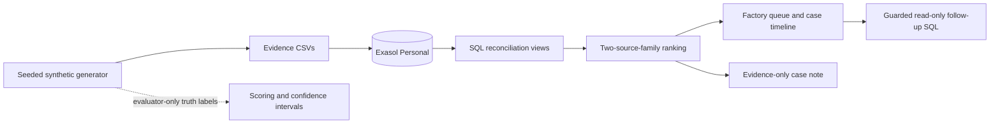
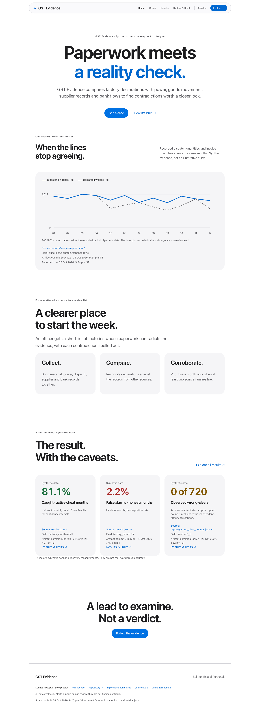

# GST Evidence Reconciliation

> A GST officer can’t tell which factories are hiding production or inflating tax credits, because every document she checks is declared by the factory itself, while the independent evidence (power use, goods movement, supplier records, bank flows) sits in separate places and is never compared. If this worked, she would start each week with a short list of units whose paperwork contradicts physical reality, each contradiction spelled out, and honest-but-unusual factories cleared.

**Author:** Kushagra Gupta, sole participant. AI coding assistants helped with implementation and documentation. Kushagra is responsible for final human review and submission.

## Judge entry points — audit of 28 October 2026

- [Live website](https://kushagragupta2005.github.io/gst-evidence-reconciliation/) · [Cases](https://kushagragupta2005.github.io/gst-evidence-reconciliation/cases/) · [Results](https://kushagragupta2005.github.io/gst-evidence-reconciliation/results/)
- [Feature status](PROJECT_STATUS.md) · [Full judge audit](docs/JUDGE_AUDIT.md) · [Required submission checklist](SUBMISSION_CHECKLIST.md)
- [Current V3 deck: PPTX](deliverables/exathon-india-2026-pitch.pptx) / [PDF](deliverables/exathon-india-2026-pitch.pdf) · [User recording script](docs/demo_script.md)

**Working synthetic prototype; required video and portal submission still outstanding.** Official deadline: **31 October 2026, 11:59 pm IST**, per the [organiser](https://www.exasol.com/events/exathon-india-2026/). Solo entry is allowed.

**Audit repair:** the live schema had defaulted to 0.10 while published evaluation used 0.05. The user approved a settings-only repair to the frozen 0.05. All 28,800 V3-C monthly live signals/flags now match the published predictions; the reader cannot access database truth. Loader defaults and the API protocol guard now prevent silently presenting mismatched decisions. [Repair evidence](reports/threshold_repair.json). The older connectivity/fresh-clone checks did not detect that drift and are historical evidence only.

## Submission status

This is a synthetic-data decision-support prototype for ExaThon India 2026, Track 03: **Factories, Fleets & Supply Chains**. It uses Exasol Personal as its primary analytical database and is licensed under MIT.

`submit-candidate-1` tags the author-machine fresh-clone verification at `f76345bc4f1670a2e6c68db6418f9a9b800f02d6`; separate-machine database reproduction remains open. V2 seed artefacts are **DEV**, because their seed suite and attribution analysis have already been seen during development. V3 is separately preregistered and reports the current held-out evaluation below.

**Public URL:** https://kushagragupta2005.github.io/gst-evidence-reconciliation/ (HTTP 200 verified 2026-10-26; snapshot mode)

## What it does

The project creates seeded synthetic evidence for factories, suppliers, invoices, e-way bills, power readings, stock, machines and bank entries. It loads that evidence into Exasol and produces monthly evidence rows for four conservation checks:

1. material input versus declared output;
2. dispatches versus invoices;
3. stock roll-forward; and
4. supplier-chain and invoice-loop evidence.

An alert is prioritised only when at least two independent source families support it. A single-family month is shown as cleared with a documented reason when available, or review-only when it remains unexplained. Ground truth is stored separately for scoring and is not available to the detection views or restricted reader account.

The checks are deterministic SQL rules. No machine-learning model decides whether a factory is flagged. An optional language-model layer writes an evidence-only case note and never changes the decision.

## Scope and limits

- **Data:** every record is synthetic. There is no taxpayer, power, e-way bill or bank data connection.
- **Decision support:** an alert is a reconciliation lead, not a finding of fraud or a tax demand. Human review is required.
- **Data access:** any real deployment would need lawful access controls for power and bank information, audit logging, retention controls and privacy assessment.
- **Evaluation:** historical metrics are synthetic scenario-recovery measurements. They do not estimate real-world fraud accuracy or prove causal independence of the signals.
- **Reproduction:** the automated fresh-checkout check reuses an installed local database runtime. A clean separate-machine run is still required before submission.

## Architecture



## Setup

### Prerequisites

- Python 3.12 or later
- Exasol Personal installed and running locally, with `SELECT 1;` succeeding
- A restricted database account configured through `EXASOL_RO_USER` and `EXASOL_RO_SECRET` for Live mode. It must have only `CREATE SESSION`, `USAGE`, and explicit `SELECT` grants on the four label-free views in [`sql/02_readonly_grants.sql`](sql/02_readonly_grants.sql).

Install the database by following the [official Exasol Personal installation instructions](https://github.com/exasol/exasol-personal#-get-started). Do not put credentials in the repository.

```sh
sh scripts/bootstrap.sh
make provision-reader
make test
make reproduce
```

`make provision-reader` creates the local `DASHBOARD_READER` account, grants only the four label-free views, and stores a generated secret in the local database credential directory with owner-only permissions. Set `EXASOL_RO_SECRET` first to provide the secret yourself.

Start the static site:

```sh
make site
```

Open `http://127.0.0.1:8081`. It starts in Snapshot mode from committed artifacts. A local Live health check also verifies the frozen source-family rule before enabling Live mode. For label-free Exasol evidence and guarded follow-ups, run `make api` in another terminal; the site shows **Live verified** only after it reaches the restricted-account API and displays that API’s UTC time and Git SHA. It accepts no arbitrary SQL. In a third terminal, run `make live-smoke` to verify the guarded Live API after the site is reachable.

**Current Live verification:** see [reports/live_smoke.json](reports/live_smoke.json) and [reports/judge_database_audit.json](reports/judge_database_audit.json) for actual dates, source commits, guard checks and measured latency. Earlier connectivity results do not establish current rule alignment.

**Reproduction scopes:** the older author-machine database clone test is retained at its original commit. Current offline-clone verification is recorded separately in [reports/clean_setup.json](reports/clean_setup.json); it does not install Exasol or replace its schemas. Not yet tested on a second machine.

## Reproduction commands

| Command | Purpose | Status |
|---|---|---|
| `make all` | Tests, restore/verify synthetic audit inputs, number audit, ablation and static build | Offline readiness pipeline; no implicit database replacement |
| `make test` | Offline unit and SQL-contract tests | Required for every change |
| `sh scripts/verify_clean_setup.sh --offline` | Actual local Git clone, new venv, locked install, tests, evidence replay and static build | Measured locally |
| `make reproduce-dev` | Regenerate the historical V2 development suite | Development only; overwrites local database/demo artefacts |
| `make reproduce` | Regenerate and load the V3-C confirmation dataset | Recreates `GST_EVIDENCE` schemas and verifies 28,800 ranked monthly rows |
| `make scale-dev` | Generate the legacy synthetic performance workload | Development only; must not be used as a V2 accuracy claim |
| `make site` | Start the static interface at `127.0.0.1:8081` | Snapshot mode works offline |
| `make api` | Start the local label-free API at `127.0.0.1:8765` | Requires the restricted account |
| `make live-smoke` | Exercise all guarded Live API endpoints and eight parallel asks | Skips clearly if Exasol is unavailable |
| `make export-site-data` | Refresh committed snapshot JSON | Reads results and reports only |

The project will add a post-change held-out command only after its seed configuration is committed. See [`docs/preregistration.md`](docs/preregistration.md) for the immutable original protocol and [`docs/PREREGISTRATION_SCORECARD.md`](docs/PREREGISTRATION_SCORECARD.md) for the current gap register.

## Evaluation evidence

V3-A selected a threshold of **0.05** and a factory queue rule of **K=3**. On primary held-out V3-B, factory-month recall was **81.14%**, false-positive rate **2.20%**, and precision **85.56%**. Confirmation holdback V3-C recorded **81.24%** recall, **2.28%** false-positive rate, and **85.01%** precision. These are synthetic scenario-recovery results, not real-world accuracy estimates. V3-B recorded **zero** active-cheat wrong clears among **3,981** active cheat months; V3-C recorded **zero** among **3,950**.

Current and historical artefacts remain available so claims can be checked:

- [`results.json`](results.json) and [`reports/v3_b_results.json`](reports/v3_b_results.json) — **HELDOUT** V3-B primary report.
- [`reports/v3_c_results.json`](reports/v3_c_results.json) — **HELDOUT** V3-C confirmation report.
- [`reports/v3_b_dispositions.json`](reports/v3_b_dispositions.json) and [`reports/v3_c_dispositions.json`](reports/v3_c_dispositions.json) — **HELDOUT** disposition outcomes, including planted fake explanations.

- [`reports/v2_seed_b_results.json`](reports/v2_seed_b_results.json) — **DEV** frozen-seed run.
- [`reports/v2_seed_c_results.json`](reports/v2_seed_c_results.json) — **DEV** frozen-seed run; no longer a new held-out result after subsequent development and analysis.
- [`reports/attribution.json`](reports/attribution.json) and [`docs/ATTRIBUTION.md`](docs/ATTRIBUTION.md) — **DEV** fixed-seed attribution study; it shows the earlier false-positive-rate change came from threshold selection, while the revised planted stock mechanism affected recall.
- [`reports/v2_threshold_tradeoff.json`](reports/v2_threshold_tradeoff.json) — **DEV** calibration trade-off.

The V3 reports include factory-month and factory-level recall, false-positive rate, precision, clustered bootstrap confidence intervals, honest misses, decoy breakdowns, ranking precision at fixed review capacity, and a discrepancy-class confusion matrix. The document disposition rate is limited to synthetic metadata verification and must not be interpreted as operational document validation.

## Data, dependencies and licences

| Component | Source | Licence or terms |
|---|---|---|
| Synthetic evidence | [`src/generate.py`](src/generate.py) | Generated by this project |
| Database client | [PyExasol](https://github.com/exasol/pyexasol) | MIT |
| Static interface | Vanilla HTML, CSS and JavaScript in [`website/`](website/) | Project source |
| Optional case-note SDK | [OpenAI Python SDK](https://github.com/openai/openai-python) | MIT |
| Optional case-note service | OpenAI API | Service terms and usage charges apply |
| Analytics database | [Exasol Personal](https://github.com/exasol/exasol-personal) | Exasol EULA |
| This project | [`LICENSE`](LICENSE) | MIT |

[`THIRD_PARTY.md`](THIRD_PARTY.md) is the dependency-licence inventory generated with `sh scripts/generate_third_party.sh`. Workload timings, when retained, are labelled as timings on the author’s MacBook and do not establish engine superiority.

## Submission material

- [Pitch deck (PPTX)](deliverables/exathon-india-2026-pitch.pptx) and [PDF](deliverables/exathon-india-2026-pitch.pdf)
- [Judge Q&A](docs/judge_qa.md)
- [Demo script](docs/demo_script.md) — recording will be made by Kushagra Gupta
- [Audit register](docs/AUDIT_VERIFICATION.md)
- [Result change log](docs/CHANGELOG_RESULTS.md)
- [Limitations](LIMITATIONS.md)

## Current release checklist

- [x] Public repository and MIT licence
- [x] Synthetic generator, Exasol schema, SQL checks, label isolation and static officer interface
- [x] Offline regression tests and GitHub Actions
- [ ] Separate-machine database installation and full end-to-end reproduction
- [x] Fresh preregistered V3-B primary and V3-C confirmation evaluations
- [ ] Final screen-recorded demo and portal submission

## Judge-facing multi-page site

`make site` serves the page at http://127.0.0.1:8081. Run `make api` separately for live guarded follow-ups. The page probes the local API for at most 1.5 seconds and keeps its bundled snapshot if unavailable. Metrics and example cases remain recorded even when the API is live.

The plain `website/metrics.js` script also works by opening any page’s `index.html` directly, offline, or under the Pages subpath. It makes no snapshot-data fetch requests. Case examples, notes, SQL and answers were recorded through the restricted API in [`reports/site_examples.json`](reports/site_examples.json); notes use the labeled deterministic fallback. The UI includes a caught cheat, a documented honest decoy, and a single-family miss.

The new ablation chart is a post-hoc replay of the frozen feature files, with source hashes and exact baseline confusion-matrix checks in [`reports/site_ablation.json`](reports/site_ablation.json). Its confidence intervals are not measured. Current API concurrency and historical scale measurements are labeled separately.

Browser verification: `npm ci`, `npx playwright install chromium`, then `npm run site:smoke` with the local site running. This checks localhost and file URLs at desktop/mobile widths, both held-out seeds, every case and follow-up, metric provenance, accessibility, console/network errors and overflow. Pages CI repeats the checks on the actual deployed URL. `npm run site:smoke -- --url <public-url>` runs the public check independently.




## Current presentation and measurement update

The site now shows zero wrong-clears as **0 of 720 active-cheat factories**, with an approximate **0.42% one-sided 95% upper bound** in each held-out seed. This is the rule of three, using factories rather than correlated months. It assumes independent factory outcomes and generated verification status; it is not a real-world safety guarantee or a cluster-bootstrap interval. See [`reports/wrong_clear_bounds.json`](reports/wrong_clear_bounds.json).

A fresh, stamped read-only comparison of the currently loaded V3-C detector is recorded in [`reports/benchmark_current_reader.json`](reports/benchmark_current_reader.json): 2,400 factories and 172,800 feature rows. Equivalent stock and supplier checks match flagged counts and gap checksums in Exasol and DuckDB. DuckDB was faster in this run. CSV-loading time is separate, Exasol ingestion is excluded, and physical plans differ. This is **not a fresh full-scale run**. The restricted account cannot load a new full-scale dataset; the previous scale record remains historical.

To repeat the comparison, install `requirements-benchmark.txt` into the project venv after the normal lockfile, then run `PYTHONPATH=. .venv/bin/python scripts/benchmark_current_reader.py` with the V3-C dataset loaded. It uses only the restricted Exasol account. `PYTHONPATH=. .venv/bin/python scripts/export_site_data.py` refreshes the public snapshot. The report records the date, commit, input hashes, detector/script hashes, hardware, repeated timings and equivalence checks.

Open gaps remain explicit: ablation confidence intervals, a sophisticated-forger test, and a second-machine reproduction. The refreshed palette, larger case buttons, two-decimal evidence, timeline legend and default question are verified by the browser checks; the problem-statement hash is unchanged.

## Judge quick-start: 3 links to open

- [Home — what the product does](https://kushagragupta2005.github.io/gst-evidence-reconciliation/)
- [Cases — caught, cleared and missed](https://kushagragupta2005.github.io/gst-evidence-reconciliation/cases/)
- [Results — held-out metrics and source links](https://kushagragupta2005.github.io/gst-evidence-reconciliation/results/)

The site has dedicated Problem, How it works, System & Stack, Data & Ethics and Limits pages. Every page uses the same audited [`data/metrics.json`](data/metrics.json). The build copies it to `website/data/metrics.json` and wraps the identical object in `website/metrics.js` for reliable offline/file-URL use. There are no separately authored page statistics. Legacy export JSON remains available for regression checks but is not loaded by the new pages.

[`docs/NUMBERS_AUDIT.md`](docs/NUMBERS_AUDIT.md) inventories the previously displayed numeric values and explains the denominator, rounding, prevalence-order and provenance corrections. Run `PYTHONPATH=. .venv/bin/python scripts/audit_site_numbers.py` to repeat the numeric audit when local V3 prediction CSVs are available. `npm run site:build` rebuilds all pages from committed artifacts without Exasol. `make site` also rebuilds before serving.

`npm run site:smoke` checks every page at 375, 768 and 1440 px in light and dark themes, including internal links, source-linked metrics, accessibility, case/seed controls and offline file URLs. Public Pages runs the same HTTP checks after deployment. `npm run site:lighthouse -- --url <site-root>` records the actual Lighthouse scores. Scores are measurements of the tested environment, not a guarantee for every connection.

Public deployment verification: all eight pages return HTTP 200, with 48 responsive/theme configurations and 64 internal-link checks passing in Pages workflow [40354940723](https://github.com/kushagragupta2005/gst-evidence-reconciliation/actions/runs/40354940723). Recorded public Lighthouse scores: Home Performance 98; all other pages Performance 100; Accessibility, Best Practices and SEO 100 throughout. See [`reports/lighthouse_public.json`](reports/lighthouse_public.json) and [`reports/pages_browser_smoke.json`](reports/pages_browser_smoke.json) for run dates and scope.

## Reproduce the published audit without a database

```sh
sh scripts/bootstrap.sh
make all
make site
```

`data/audit/` contains compressed, hash-verified synthetic A/B/C feature exports and evaluator predictions so the audit and bootstrap intervals work from a clone. Restore only: `make restore-audit`. Detailed recheck: `make audit`. Raw databases and millions of generated CSV rows are regenerated from the source; credentials, venvs and database images are excluded from Git.

For flaky package-network access, build an OS/Python-compatible wheelhouse with `pip download --retries 10 --timeout 60 -r requirements-lock.txt -d wheelhouse`, then use `PIP_NO_INDEX=1 PIP_FIND_LINKS=/absolute/path/to/wheelhouse sh scripts/verify_clean_setup.sh --offline`. The helper uses a real local clone and a fresh isolated venv. Wheels are local build caches, not submission data, and are not uploaded.

The current API's new protocol validation adds work; use the p50/p95 in the latest `reports/live_smoke.json`, not a historical latency quoted elsewhere. `make reproduce` is the explicit database replacement path; `verify_clean_setup.sh --with-exasol` is opt-in and also replaces the evidence schema.

## AI and authoring disclosure

OpenAI Codex coding assistants helped write and audit the project. Exact model identities for earlier sessions were not consistently recorded; no model comparison or model-backed detection is claimed. The optional OpenAI note SDK/API path is implemented but the demonstrated case notes use the labeled deterministic fallback. The LLM never decides alerts. The pitch was edited with the supplied Artifact Tool runtime; export details and its PDF fallback are in deliverables/README.md. Browser verification uses Playwright, axe and Lighthouse; these are development tools, not runtime dependencies of the static site.
