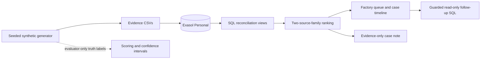

# GST Evidence Reconciliation

> A GST officer can’t tell which factories are hiding production or inflating tax credits, because every document she checks is declared by the factory itself, while the independent evidence (power use, goods movement, supplier records, bank flows) sits in separate places and is never compared. If this worked, she would start each week with a short list of units whose paperwork contradicts physical reality, each contradiction spelled out, and honest-but-unusual factories cleared.

**Author:** Kushagra Gupta, sole participant. AI coding assistants helped with implementation and documentation; Kushagra reviewed the work and its reported artefacts.

## Submission status

This is a synthetic-data decision-support prototype for ExaThon India 2026, Track 03: **Factories, Fleets & Supply Chains**. It uses Exasol Personal as its primary analytical database and is licensed under MIT.

`submit-candidate-1` is not yet tagged because separate-machine database reproduction remains open. V2 seed artefacts are **DEV**, because their seed suite and attribution analysis have already been seen during development. V3 is separately preregistered and reports the current held-out evaluation below.

## What it does

The project creates seeded synthetic evidence for factories, suppliers, invoices, e-way bills, power readings, stock, machines and bank entries. It loads that evidence into Exasol and produces monthly evidence rows for four conservation checks:

1. material input versus declared output;
2. dispatches versus invoices;
3. stock roll-forward; and
4. supplier-chain and invoice-loop evidence.

An alert is prioritised only when at least two independent source families support it. A single-family month is shown as cleared with a documented reason when available, or review-only when it remains unexplained. Ground truth is stored separately for scoring and is not available to the detection views or dashboard account.

The checks are deterministic SQL rules. No machine-learning model decides whether a factory is flagged. An optional language-model layer writes an evidence-only case note and never changes the decision.

## Scope and limits

- **Data:** every record is synthetic. There is no taxpayer, power, e-way bill or bank data connection.
- **Decision support:** an alert is a reconciliation lead, not a finding of fraud or a tax demand. Human review is required.
- **Data access:** any real deployment would need lawful access controls for power and bank information, audit logging, retention controls and privacy assessment.
- **Evaluation:** historical metrics are synthetic scenario-recovery measurements. They do not estimate real-world fraud accuracy or prove causal independence of the signals.
- **Reproduction:** the automated fresh-checkout check reuses an installed local database runtime. A clean separate-machine run is still required before submission.

## Architecture



## Setup

### Prerequisites

- Python 3.12 or later
- Exasol Personal installed and running locally, with `SELECT 1;` succeeding
- A restricted database account configured through `EXASOL_RO_USER` and `EXASOL_RO_SECRET` for the dashboard. It must have only `CREATE SESSION`, `USAGE`, and explicit `SELECT` grants on the four dashboard views in [`sql/02_readonly_grants.sql`](sql/02_readonly_grants.sql).

Install the database from the [official Exasol Personal repository](https://github.com/exasol/exasol-personal). Do not put credentials in the repository.

```sh
sh scripts/bootstrap.sh
make provision-dashboard
make test
```

`make provision-dashboard` creates the local `DASHBOARD_READER` account, grants only the four label-free views, and stores a generated secret in the local database credential directory with owner-only permissions. Set `EXASOL_RO_SECRET` first to provide the secret yourself.

Start the dashboard:

```sh
make dashboard
```

The dashboard shows a ranked factory queue, evidence timeline, signal contributions, clear/review-only dispositions, deterministic case-note fallback, and three guarded follow-up templates. It accepts no arbitrary SQL.

## Reproduction commands

| Command | Purpose | Status |
|---|---|---|
| `make test` | Offline unit and SQL-contract tests | Required for every change |
| `sh scripts/verify_clean_setup.sh --offline` | Fresh source tree and Python environment, then offline tests | Measured locally |
| `make reproduce-dev` | Regenerate the historical V2 development suite | Development only; overwrites local database/demo artefacts |
| `make scale-dev` | Generate the legacy synthetic performance workload | Development only; must not be used as a V2 accuracy claim |
| `make dashboard` | Start the local Streamlit application | Requires the restricted account |

The project will add a post-change held-out command only after its seed configuration is committed. See [`docs/preregistration.md`](docs/preregistration.md) for the immutable original protocol and [`docs/PREREGISTRATION_SCORECARD.md`](docs/PREREGISTRATION_SCORECARD.md) for the current gap register.

## Evaluation evidence

V3-A selected a threshold of **0.05** and a factory queue rule of **K=3**. On primary held-out V3-B, factory-month recall was **81.14%**, false-positive rate **2.20%**, and precision **85.56%**. Confirmation holdback V3-C recorded **81.24%** recall, **2.28%** false-positive rate, and **85.01%** precision. These are synthetic scenario-recovery results, not real-world accuracy estimates. V3-B recorded **zero** active-cheat wrong clears among **3,981** active cheat months; V3-C recorded **zero** among **3,950**.

Current and historical artefacts remain available so claims can be checked:

- [`results.json`](results.json) and [`reports/v3_b_results.json`](reports/v3_b_results.json) — **HELDOUT** V3-B primary report.
- [`reports/v3_c_results.json`](reports/v3_c_results.json) — **HELDOUT** V3-C confirmation report.
- [`reports/v3_b_dispositions.json`](reports/v3_b_dispositions.json) and [`reports/v3_c_dispositions.json`](reports/v3_c_dispositions.json) — **HELDOUT** disposition outcomes, including planted fake explanations.

- [`reports/v2_seed_b_results.json`](reports/v2_seed_b_results.json) — **DEV** frozen-seed run.
- [`reports/v2_seed_c_results.json`](reports/v2_seed_c_results.json) — **DEV** frozen-seed run; no longer a new held-out result after subsequent development and analysis.
- [`reports/attribution.json`](reports/attribution.json) and [`docs/ATTRIBUTION.md`](docs/ATTRIBUTION.md) — **DEV** fixed-seed attribution study; it shows the earlier false-positive-rate change came from threshold selection, while the revised planted stock mechanism affected recall.
- [`reports/v2_threshold_tradeoff.json`](reports/v2_threshold_tradeoff.json) — **DEV** calibration trade-off.

The V3 reports include factory-month and factory-level recall, false-positive rate, precision, clustered bootstrap confidence intervals, honest misses, decoy breakdowns, ranking precision at fixed review capacity, and a discrepancy-class confusion matrix. The document disposition rate is limited to synthetic metadata verification and must not be interpreted as operational document validation.

## Data, dependencies and licences

| Component | Source | Licence or terms |
|---|---|---|
| Synthetic evidence | [`src/generate.py`](src/generate.py) | Generated by this project |
| Database client | [PyExasol](https://github.com/exasol/pyexasol) | MIT |
| Dashboard | [Streamlit](https://github.com/streamlit/streamlit) | Apache-2.0 |
| Optional case-note SDK | [OpenAI Python SDK](https://github.com/openai/openai-python) | MIT |
| Optional case-note service | OpenAI API | Service terms and usage charges apply |
| Analytics database | [Exasol Personal](https://github.com/exasol/exasol-personal) | Exasol EULA |
| This project | [`LICENSE`](LICENSE) | MIT |

[`THIRD_PARTY.md`](THIRD_PARTY.md) is the dependency-licence inventory generated with `sh scripts/generate_third_party.sh`. Workload timings, when retained, are labelled as timings on the author’s MacBook and do not establish engine superiority.

## Submission material

- [Pitch deck (PPTX)](deliverables/exathon-india-2026-pitch.pptx) and [PDF](deliverables/exathon-india-2026-pitch.pdf)
- [Judge Q&A](docs/judge_qa.md)
- [Demo script](docs/demo_script.md) — recording will be made by Kushagra Gupta
- [Audit register](docs/AUDIT_VERIFICATION.md)
- [Result change log](docs/CHANGELOG_RESULTS.md)

## Current release checklist

- [x] Public repository and MIT licence
- [x] Synthetic generator, Exasol schema, SQL checks, label isolation and dashboard
- [x] Offline regression tests and GitHub Actions
- [ ] Separate-machine database installation and full end-to-end reproduction
- [x] Fresh preregistered V3-B primary and V3-C confirmation evaluations
- [ ] Final screen-recorded demo and portal submission
