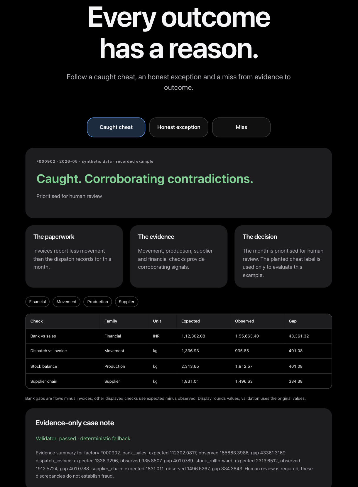
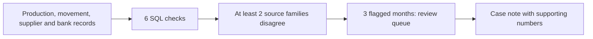
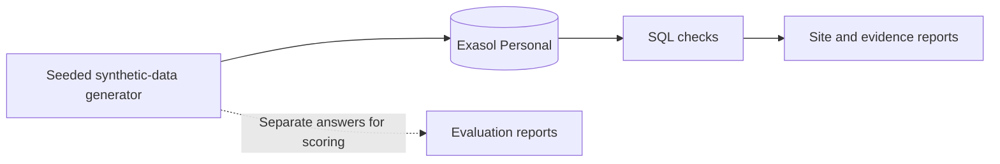

# GST Evidence
Help GST officers find factories whose paperwork disagrees with the evidence, using Exasol Personal.

**[🌐 Live site](https://kushagragupta2005.github.io/gst-evidence-reconciliation/)** · [Demo video](https://github.com/kushagragupta2005/gst-evidence-reconciliation/releases/tag/walkthrough-2026-10-29) · [Pitch PDF](00_SUBMISSION/Pitch.pdf) · [Pitch PPTX](00_SUBMISSION/Pitch.pptx)

[](https://kushagragupta2005.github.io/gst-evidence-reconciliation/cases/)

[](https://github.com/kushagragupta2005/gst-evidence-reconciliation/actions/workflows/tests.yml) [](LICENSE)

## The problem
Imagine checking a shop’s sales using only the owner’s diary. Electricity bills, truck records, supplier statements and bank payments could tell a different story. GST officers need those separate records brought together, with each disagreement explained.

<details><summary>Original competition problem statement — preserved verbatim</summary>

> A GST officer can’t tell which factories are hiding production or inflating tax credits, because every document she checks is declared by the factory itself, while the independent evidence (power use, goods movement, supplier records, bank flows) sits in separate places and is never compared. If this worked, she would start each week with a short list of units whose paperwork contradicts physical reality, each contradiction spelled out, and honest-but-unusual factories cleared.

</details>

## What we do
1. **Collect evidence:** bring together production, goods movement, supplier and bank records.
2. **Compare:** run six SQL checks—database rules that compare output, dispatches, stock, supplier returns, bank receipts and bank payments with declarations.
3. **Flag carefully:** require disagreements in at least two source families; three flagged months put a factory in the review queue. These are separate evidence groups, not proven statistically independent signals.
4. **Explain:** show the expected value, recorded value and gap for each flag, plus a case note for an officer to review.

**Source families** are groups of related evidence: production, movement, suppliers and finances.

### Sample flagged case
> **F000902 · May 2026 · recorded synthetic example.**<br>
> Dispatch records show **1,336.9296 kg**; invoices show **935.8507 kg**—a **401.0789 kg** gap.<br>
> **Four source families** raised signals, so this month was prioritised for human review. [Inspect the evidence](reports/site_examples.json).

## How a case reaches an officer


## How it is built
Exasol Personal stores the evidence and runs the SQL checks that feed the site and reports.


## What 'model' are we using?
The detector is a transparent rule-based SQL system. It cross-checks declarations against physical and financial evidence; no ML or LLM decides flags. V3-A selected threshold **0.05** and the three-month queue rule; those choices were frozen and tested on V3-B and V3-C.
**V3-A/B/C** are three separately seeded synthetic datasets: A chooses the settings; B and C test them.

| Component | What it is | Does it decide flags? |
|---|---|---|
| Detection | Six SQL checks and the source-family rule | Yes |
| Displayed case notes | Fixed sentences from evidence; numbers checked against their source rows | No |
| Optional LLM notes | OpenAI Responses API; code default `gpt-6-astra`, overridable by `OPENAI_MODEL`; no live model-backed demo claimed | No |
<details><summary>Inspect the rules and note writer</summary>

[SQL checks](sql/10_checks.sql) · [Case-note code and validator](src/case_notes.py) · [Detailed method and limits](docs/PROJECT_GUIDE.md#limits). The deterministic template is the demonstrated fallback. Optional generated notes are rejected if numeric validation fails; this does not verify every statement’s meaning.

</details>

## Results
**2,400 synthetic factories · 12 months · 28,800 factory-months per seed.** **Precision** means the share of flagged months that were planted cheats: of 100 flagged months, ~85 are real cheats **within the synthetic test**.
| Held-out test | Cheating months caught | Honest months falsely flagged | Precision |
|---|---:|---:|---:|
| V3-B · primary | 81.14% | 2.20% | 85.56% |
| V3-C · confirmation | 81.24% | 2.28% | 85.01% |
Synthetic data, not real-world accuracy. [Results and confidence intervals](https://kushagragupta2005.github.io/gst-evidence-reconciliation/results/) · [Source reports](docs/README.md#evaluation).

## Quick start
Requires Git, Make and Python 3.12+. These four commands start the recorded demo without a database or API key.
```sh
git clone https://github.com/kushagragupta2005/gst-evidence-reconciliation.git
cd gst-evidence-reconciliation
sh scripts/bootstrap.sh
make site
```
Open **http://127.0.0.1:8081/**. [Tests, audit reproduction and live Exasol setup](docs/PROJECT_GUIDE.md#run-and-reproduce).

## Repo map
```text
00_SUBMISSION/  Pitch PDF, PPTX and video link
website/        Public demo pages
sql/            Database checks and access rules
src/            Data generator, scoring, notes and local API
tests/          Regression and guard checks
reports/        Measured results and verification records
```
<details><summary>Supporting documentation and data</summary>

`docs/` holds the [documentation index](docs/README.md), project guide, licences and historical archive. `data/` holds synthetic evaluation inputs and the recorded site data. See [reproduction inputs](data/audit/README.md).

</details>

## Limits, licence and credits

- All records are synthetic; real-world accuracy is untested.
- Document verification is generated, not independently authenticated.
- Flags need human review; false alarms and missed cheats remain possible.
- Forger testing, current full-scale testing and second-machine reproduction remain open. [Full limitations](docs/PROJECT_GUIDE.md#limits).

[MIT licence](LICENSE) · [Third-party licences](docs/README.md#licences-and-disclosures).
Built by **Kushagra Gupta**, solo participant, for **ExaThon India 2026 — Money, Risk & Regulation**.
OpenAI Codex coding assistants helped build and audit the project. The optional LLM only writes notes; it does not decide flags.
