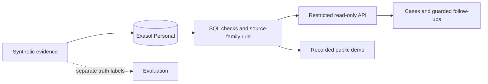

# Project guide

[Pitch PDF](../00_SUBMISSION/Pitch.pdf) · [Pitch PPTX](../00_SUBMISSION/Pitch.pptx) · [Video](https://github.com/kushagragupta2005/gst-evidence-reconciliation/releases/tag/walkthrough-2026-10-29) · [Demo](https://kushagragupta2005.github.io/gst-evidence-reconciliation/)

[Setup](#run-and-reproduce) · [Implementation status](#implementation-status) · [Limits](#limits) · [Submission details](#submission-details)

This is the single reference for setup, verification scope, outstanding work and submission notes. The short project overview is in the [README](../README.md).

## Architecture



## Run and reproduce

### Recorded demo and offline audit

Prerequisites: Git, Make, Python 3.12+ and network access for the first dependency installation. No Exasol instance or LLM API key is needed for this mode.

```sh
git clone https://github.com/kushagragupta2005/gst-evidence-reconciliation.git
cd gst-evidence-reconciliation
sh scripts/bootstrap.sh
make all
make site
```

Open http://127.0.0.1:8081/. Stop the server with Ctrl+C. The public equivalent is the [GitHub Pages site](https://kushagragupta2005.github.io/gst-evidence-reconciliation/).

Expected output: regression tests pass; archived A/B/C features and predictions restore with matching hashes; calibration, held-out metrics and ablation replay; the static pages build. The offline pipeline does not contact or replace Exasol. The site displays its mode, source commit and recorded timestamps. All examples are synthetic.

Measured reproduction scope: a real local clone and fresh venv passed in 22 seconds using cached pinned wheels on the author's machine at commit `91b53c51b0ff0344f8c51204f9b6a7c87323a4c3`. First-time downloads and database setup take additional time; their duration is not measured by that result. No second-machine verification is claimed. [Report](../reports/clean_setup.json).

### Local live Exasol queries

Install and start Exasol Personal using its [official instructions](https://github.com/exasol/exasol-personal#-get-started). Verify `SELECT 1;` using your local credentials. Do not put credentials in Git.

If the V3-C schema and restricted reader already exist:

```sh
make api
## In another terminal:
make site
## In a third terminal, to check the API:
make live-smoke
```

The API binds 127.0.0.1:8765; the site binds 127.0.0.1:8081. `EXASOL_DSN`, `EXASOL_RO_USER` and `EXASOL_RO_SECRET` configure the restricted reader. The default local reader is DASHBOARD_READER, with its secret kept outside the repo. Grant only CREATE SESSION, schema USAGE and explicit SELECT on the four label-free views in [sql/02_readonly_grants.sql](../sql/02_readonly_grants.sql).

Live queries use three fixed SELECT intents, a 200-row limit, a 30-second database timeout and a rate limit. They cannot submit arbitrary SQL or read truth. The API checks the frozen rule before enabling Live responses. Without a reachable API, the site keeps the recorded snapshot. The curated example evidence remains recorded even when follow-ups are live.

The [28 October live smoke](../reports/live_smoke.json) and [database audit](../reports/judge_database_audit.json) record actual scope, commit, guard checks and latency. They are dated results, not a claim the database is currently running.

### Generate and load V3-C

These commands need the loader's write-capable account. They are separate from read-only runtime queries. **`make reproduce` drops and recreates GST_EVIDENCE and replaces its data.** Run only against an authorised local demo database.

```sh
make provision-reader
make reproduce
```

The first command creates/repairs the local reader account using loader credentials and stores its secret outside the repo with owner-only permissions. Set `EXASOL_RO_SECRET` first to supply a secret yourself. The loader reapplies restricted grants after creating the views. The reproduction target generates seed 51003, loads label-free tables, fixes the threshold to the published protocol, checks joins/counts and exports features. Expected output: 28,800 ranked monthly rows and the report `reports/reproduction_v3_c_load.json`. Evaluator truth stays outside the detection schema.

### Commands

| Command | Purpose |
|---|---|
| `make test` | Offline regression tests and generated-data SQL smoke |
| `make restore-audit` | Restore exact compressed synthetic scoring inputs |
| `make audit` | Recompute calibration, B/C metrics and ablation |
| `make all` | Tests, audit and static export |
| `make site` / `make api` | Recorded site / restricted local API |
| `make live-smoke` | API endpoints, guards and eight parallel requests; clear skip if DB unavailable |
| `sh scripts/verify_clean_setup.sh --offline` | New local clone, new venv, pinned install and offline pipeline |
| `make export-site-data` | Refresh snapshot from result/report artifacts |

`verify_clean_setup.sh --with-exasol` also replaces local evidence data; it is explicitly opt-in. Historical V2 and scale-development commands remain in Makefile for traceability, not as current held-out claims. The original submit-candidate-1 tag is historical; its older verification does not certify later changes.

### Unreliable package network

Use the bootstrap's retry options or prepare an OS/Python-compatible local wheelhouse:

```sh
python3 -m pip download --retries 10 --timeout 60 -r requirements-lock.txt -d wheelhouse
PIP_NO_INDEX=1 PIP_FIND_LINKS="$PWD/wheelhouse" sh scripts/verify_clean_setup.sh --offline
```

Do not upload wheels, venvs, database images or credentials.

### Browser and numeric checks

```sh
npm ci
npx playwright install chromium
npm run site:smoke -- --url https://kushagragupta2005.github.io/gst-evidence-reconciliation/
PYTHONPATH=. .venv/bin/python scripts/audit_site_numbers.py
```

The browser check covers eight pages at three widths in both themes, source-linked numbers, case controls, accessibility and console/network failures. Local mode also checks file URLs. GitHub Pages repeats the public check after deployment. Lighthouse results are recorded environment-specific measurements, not guaranteed scores.

### Performance and provenance

Current small V3-C comparison: [benchmark_current_reader.json](../reports/benchmark_current_reader.json), 2,400 factories and 172,800 check rows. Matching stock/supplier counts and gap checksums were verified. DuckDB was faster; ingestion and physical plans differ. Install scripts/requirements/benchmark.txt and run `PYTHONPATH=. .venv/bin/python scripts/benchmark_current_reader.py` to repeat it with V3-C already loaded. This uses only the reader.

The 20.98-million-row run is historical DEV, predating the current detector. It is not fresh current-scale proof. Current eight-request latency includes protocol-guard work; use the latest live_smoke artifact instead of older figures. No MCP, UDF or 50-session demonstration is claimed.

The repaired live threshold mismatch and open tertiary ranking-key difference are documented in [the audit](JUDGE_AUDIT.md). [reports/SUBMISSION_MANIFEST.json](../reports/SUBMISSION_MANIFEST.json) hashes publishable files; [ARTIFACT_INDEX.json](../reports/ARTIFACT_INDEX.json) separates current from historical results. Detailed formulas and evaluation tables remain in the audit rather than being repeated on the front page.

## Implementation status

**A working synthetic decision-support prototype. The final submission video has been uploaded; the portal form still needs to be submitted.** This register is based on code and recorded verification, not a checklist completion claim.

| Component | Status | Evidence / limit |
|---|---|---|
| Public repo, MIT, sole author | VERIFIED | GitHub PUBLIC; LICENSE; git history; author Kushagra Gupta |
| Submission track | 01 — Money, Risk & Regulation | GST fraud investigation and tax compliance; manufacturing records supply the evidence. Updated 29 October 2026. |
| Required problem statement | VERIFIED | Verbatim hash test; README and Problem page |
| Synthetic generator | VERIFIED | Deterministic tests; reports/dataset_inventory.json; three cheat types, three intensities, six decoy types, twelve months |
| Exasol Personal primary database | LIVE VERIFIED after repair | reports/judge_database_audit.json; restricted reader; 2,400 factories, 28,800 factory-months, 172,800 features |
| Frozen threshold and queue | VERIFIED | 0.05 and K=3 chosen on V3-A; reports/threshold_repair.json; all 28,800 live signals/flags match V3-C |
| Six SQL checks / four source families | VERIFIED | sql/10_checks.sql; SQL smoke and hand-case tests; two-family rule |
| Supplier loop tracing | IMPLEMENTED AS CONTEXT | Loop indicator appears in evidence; loop-only trigger, general rings and graph scoring are not implemented |
| Ranking tie-breaker | OPEN ALIGNMENT ITEM | SQL sums firing-family exposure maxima; frozen evaluator uses a global maximum. See reports/ranking_alignment_audit.json; do not claim identical tertiary semantics |
| Entity normalisation | IMPLEMENTED, batch SQL | sql/20_entities.sql; no validated cross-factory entity-resolution model |
| B/C scoring, intervals, decoys, evasive metrics | VERIFIED OFFLINE | results.json and reports/v3_c_results.json; scripts/audit_site_numbers.py reproduces saved metrics |
| Ablation | VERIFIED POINT ESTIMATES | Frozen feature hashes and baseline matrices checked; ablation intervals unmeasured |
| Wrong-clear result | CONDITIONAL SYNTHETIC RESULT | Zero events; factory-level approximate rule-of-three bound. Verification status is generator metadata; no forger test or cluster-bootstrap wrong-clear CI |
| Note validator and fallback | VERIFIED | tests/test_notes.py; current live smoke; numeric field binding is checked, not full semantic/legal validity |
| Optional LLM-written notes | IMPLEMENTED, NOT LIVE DEMONSTRATED | src/case_notes.py; no API-key-backed run is claimed; LLM never decides flags |
| Guarded follow-up SQL | LIVE VERIFIED | Three fixed SELECT intents, allow-list, row limit, timeout, rate limit; injection rejected |
| Real MCP / Python UDF demo | NOT IMPLEMENTED / NOT DEMONSTRATED | No claim of a working MCP or UDF is made |
| Current Exasol vs DuckDB | RECORDED COMPARISON | Current small V3-C dataset; matching counts/gaps; DuckDB faster; ingestion/physical-plan differences disclosed |
| 20.98M-row scale | HISTORICAL DEV | Predates current detector; not a fresh current full-scale claim |
| Current concurrency | LIVE VERIFIED, EIGHT REQUESTS | reports/live_smoke.json; includes frozen-protocol check overhead; no 50-session result |
| Eight-page site | DEPLOYED SNAPSHOT | GitHub Pages; recorded cases/answers/metrics; local API can execute follow-ups live |
| Reproducible audit evidence | PACKAGED | data/audit/*/*.gz + manifest; exact synthetic features/predictions restored and verified |
| Fresh-clone setup | OFFLINE CLONE VERIFIED | Source 91b53c51b0ff0344f8c51204f9b6a7c87323a4c3; real clone, new venv, pinned cached wheels, tests, calibration/metric replay and static build; 22 seconds; no runtime installation or second machine |
| Current PPTX/PDF/script/Q&A | UPDATED V3 | 00_SUBMISSION/ and docs/; previous V2 deck moved to docs/archive/legacy/submission/ |
| Demo video | UPLOADED | [Final submission video](https://github.com/kushagragupta2005/gst-evidence-reconciliation/releases/tag/walkthrough-2026-10-29); original user-recorded MP4, unchanged |
| Portal submission | USER ACTION REQUIRED | No form submission is claimed; required owner declarations and consent remain pending |
| Submission deadline | CONFLICTING OFFICIAL PAGES | Event page: 31 October; submission page: 25 October. Rechecked 29 October; acceptance requires organiser confirmation |
| Real taxpayer validation | NOT DONE | No taxpayer records; lawful data access, privacy and field validation remain future work |

See [judge audit](JUDGE_AUDIT.md), [submission checklist](PROJECT_GUIDE.md#submission-details), and [limits](PROJECT_GUIDE.md#limits). Historical reports remain for traceability. “VERIFIED” means the named check passed in the stated environment; it does not certify real-world accuracy.

## Limits

- All data, labels, documents, outcomes and document-verification statuses are generated by this repository. A `verified` document is synthetic generator metadata, not an independent operational verification result.
- V3-B and V3-C report synthetic scenario recovery only. They do not estimate real taxpayer fraud accuracy, causal independence of signals, or deployment value.
- The language-model option can only draft a note from returned evidence and its numeric validator can reject a note. It never determines an alert, a clearance, fraud, or legal liability.
- Snapshot mode contains committed evaluation and performance artifacts. Three selected cases and guarded follow-up answers are recorded from the restricted API in reports/site_examples.json. Live follow-ups require the local API and Exasol; recorded cases do not refresh automatically.
- The current committed evaluation has no sophisticated-forger scenario, wrong-clear cluster-bootstrap confidence interval, before/after verified-document clearing comparison, paired stock-aware evasive comparison, 2% prevalence result, or 50-session concurrency measurement.
- The 20.98 million-row performance record predates the current detector. It is a development workload timing on the author's MacBook, not a production benchmark or speed claim.
- A real deployment would require lawful, proportionate access to tax, power and bank records, controls for privacy and retention, and human review before any action affecting a taxpayer.

- The Results page includes post-hoc leave-one-check-out point estimates in `reports/site_ablation.json`. Both complete-check confusion matrices reproduce the frozen held-out artifacts. Ablation confidence intervals remain unmeasured. Recorded cases are selected using offline evaluation labels; API queries themselves have no truth access.

- `reports/wrong_clear_bounds.json` gives an approximate one-sided 95% rule-of-three bound over active-cheat factories after zero observed wrong-clear factories. Factory months are not treated as independent trials. Independent factory outcomes are assumed; this is conditional on generated verification status and is not a real-world safety guarantee or cluster-bootstrap interval.
- The new full-scale run remains pending: the authorised restricted account cannot load a new dataset or rewrite views. The existing 20.98-million-row run remains historical. A second-machine reproduction remains unverified.

- `reports/benchmark_current_reader.json` measures current V3-C Exasol views and equivalent DuckDB checks on CSV-loaded tables. Counts and gap checksums agree; execution stages and physical plans differ. DuckDB load time is separate; Exasol ingestion was not measured. It is not a full-scale run, and no general speed advantage is claimed.

- The 28 October audit found a live default threshold of 0.10 while published V3 evaluation used 0.05. The authorised settings-only repair restored 0.05 and all monthly live flags/signal counts matched V3-C. Source defaults and a fail-closed API guard now check rule consistency. Earlier connectivity/count-only checks did not establish that consistency; see reports/threshold_repair.json.
- The new guard adds work to each API request. Current concurrency timing is the latest reports/live_smoke.json and is not directly comparable with the earlier unguarded timing. Historic latency artifacts are retained under docs/archive/legacy/evidence/.
- The user-recorded final submission video is available through the README. No portal submission or organiser acceptance is claimed.

- Ranking has an open tertiary-key alignment issue: SQL sums firing-family exposure maxima, while the frozen evaluator uses a global exposure maximum. Signals and flags match; exact queue ordering is diagnosed in reports/ranking_alignment_audit.json. Historical precision is not relabelled as a new ranking evaluation.

## Submission details

Sources rechecked 29 October 2026: [event page](https://www.exasol.com/events/exathon-india-2026/) and [submission page](https://www.exasol.com/events/exathon-india-2026/submit-your-project/).

**Deadline unresolved:** the event page says **31 October 2026, 11:59 pm IST**; the submission page says **25 October 2026, 11:59 pm IST**. Both are official and were accessible on 29 October. An open form does not prove that an entry will be accepted. Organiser confirmation is needed; no eligibility or acceptance is claimed here.

Solo entrants are allowed (teams of one to three). Registration was reported complete by Kushagra. The final portal submission, required declarations and consent remain owner actions.

| Requirement | Status | Where / action |
|---|---|---|
| Clear technology-free problem statement | READY | README opening, website Problem page, deck |
| Public repository | VERIFIED PUBLIC | https://github.com/kushagragupta2005/gst-evidence-reconciliation |
| Exasol Personal as data platform | VERIFIED | src/, sql/, current restricted DB audit and Live smoke |
| MIT or Apache licence | READY: MIT | LICENSE |
| Public or synthetic data only | READY: SYNTHETIC | Generator, data/audit/, provenance inventory |
| Work created during challenge window | GIT EVIDENCE | First commit f015d5b: 19 October 2026, after registration opened 5 October; timestamps alone cannot independently prove originality |
| Deck, PDF or PPT | READY: CURRENT V3 | 00_SUBMISSION/Pitch.pptx and .pdf |
| Demo video | UPLOADED | [Final submission video](https://github.com/kushagragupta2005/gst-evidence-reconciliation/releases/tag/walkthrough-2026-10-29), recorded by Kushagra Gupta |
| Clean README with setup and usage | READY | Concise README; docs/PROJECT_GUIDE.md; exact reproduction scope linked |
| Deployment instructions and run guide | READY | README, Makefile, website/README.md |
| AI/tools/data disclosure | READY | README, THIRD_PARTY*, 00_SUBMISSION/README, data/README |
| Final review, declarations, consent and portal submission | NOT DONE | Kushagra reviews the actual files and submits via the official event page |

### Submission fields

- Author: **Kushagra Gupta**. Sole participant. Do not add fictional teammates.
- Track: **01 — Money, Risk & Regulation**. The primary problem is GST fraud investigation and tax compliance; factory and supply-chain records provide supporting evidence.
- Website: https://kushagragupta2005.github.io/gst-evidence-reconciliation/
- Cases: https://kushagragupta2005.github.io/gst-evidence-reconciliation/cases/
- Results: https://kushagragupta2005.github.io/gst-evidence-reconciliation/results/
- Video URL: https://github.com/kushagragupta2005/gst-evidence-reconciliation/releases/tag/walkthrough-2026-10-29
- Repository commit/release: use the current public main and the submission manifest; do not imply an older tag verifies new changes.

The repository contains the named materials. Presence and public access do not certify every organiser condition. Licence inventories and heuristic scans assist owner review; they are not an absolute legal or ownership guarantee. Kushagra must review the declarations and consent personally. This audit does not submit the form or establish organiser acceptance.

[Material/access verification report — 29 October](../reports/submission_readiness_2026-10-29.json): repository, demo, both deck formats, licence and video returned HTTP 200.

## Deck authoring

The deck is generated from result/report artifacts by `scripts/update_submission_deck.mjs` using the Codex bundled Artifact Tool (authoring dependency; not needed to run the app). The native PDF exporter failed in that runtime on a missing standard-font module, so the PDF was rendered from the inspected slide PNGs with `scripts/render_pitch_pdf.py`. Its editable source remains the PPTX. Optional public PDF-export dependencies are pinned in scripts/requirements/authoring.txt. Neither PowerPoint nor a second machine has been used to verify the final deck.

The user-recorded final submission video is hosted on GitHub Releases. Portal submission has not been performed.
